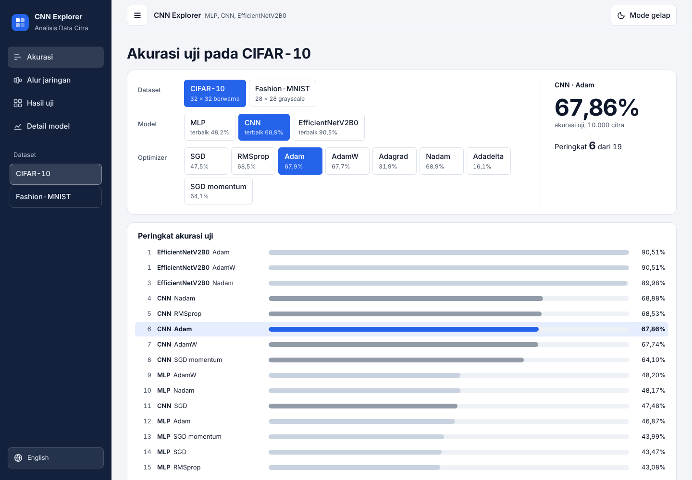
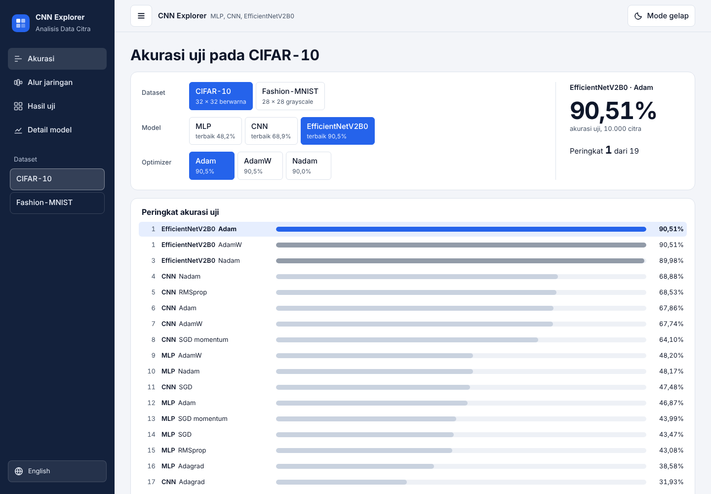
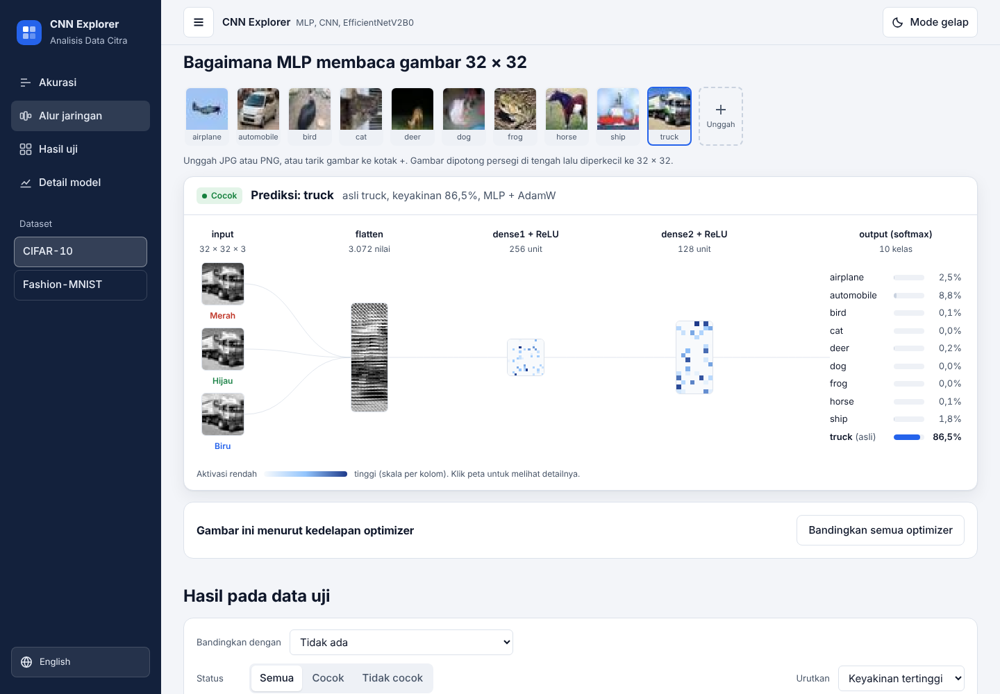
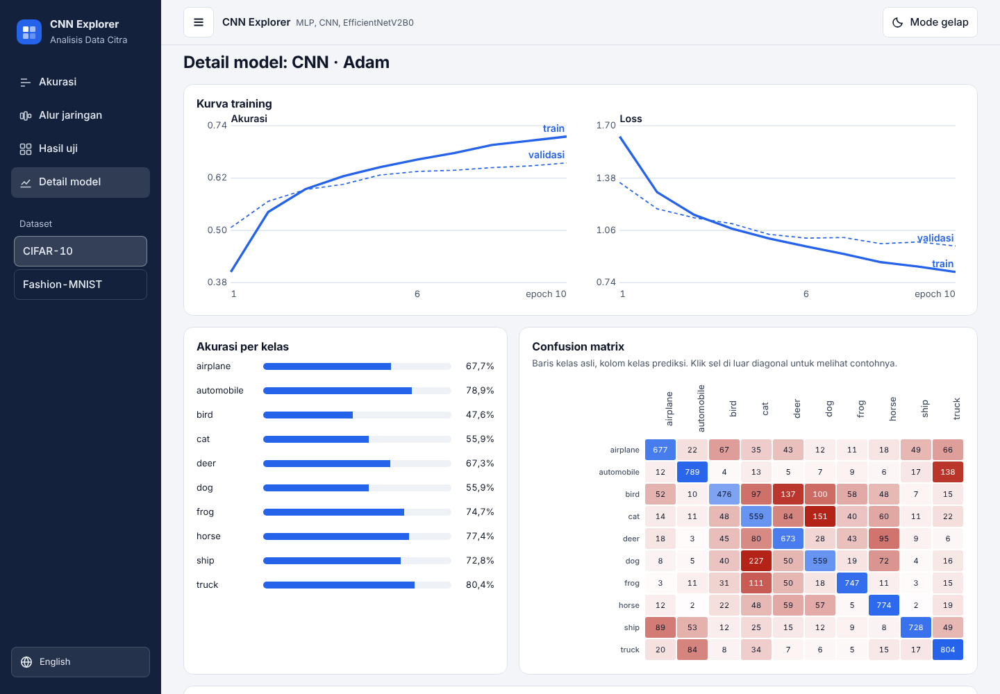
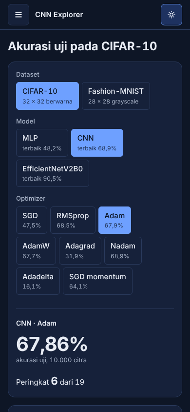

# CNN Optimizer Explorer

[English](README.md) | **Bahasa Indonesia**

Halaman web interaktif yang membuka isi sebuah *convolutional neural network* (CNN) kecil dan memperlihatkan apa yang dilakukannya terhadap gambar, layer demi layer. Kamu bisa berpindah antara dua dataset (foto CIFAR-10 dan pakaian Fashion-MNIST) dan delapan optimizer, mengunggah gambar sendiri, dan melihat di mana model menebak dengan benar maupun salah. Bagian kedua membandingkan tiga arsitektur, yaitu MLP biasa, CNN kecil, dan EfficientNetV2B0 hasil pretraining, dengan satu protokol terkontrol: split data yang sama, seed berpasangan, dan checkpoint yang dipilih dengan macro-F1 validasi.

**Dashboard langsung: https://febrianggi.github.io/CNN-Implementer/dashboard/index.id.html**

Tidak ada server: CNN berjalan di browser-mu, dan gambar yang kamu unggah tidak keluar dari komputermu. Prediksi uji model lain dihitung di Python lalu dimuat dari berkas.



## Untuk apa ini?

CNN biasanya dijelaskan dengan diagram kotak dan panah. Halaman ini memperlihatkan wujud aslinya: feature map dan kernel dari model yang benar-benar dilatih, dihitung langsung untuk gambar yang kamu pilih. Halaman ini dibuat untuk mahasiswa dan siapa saja yang sedang belajar cara kerja CNN, dan menjawab empat pertanyaan:

- **Apa yang dilakukan setiap layer terhadap gambar?** Ikuti satu gambar dari channel warnanya sampai probabilitas kelas di akhir.
- **Apakah optimizer berpengaruh?** Jaringan yang sama dilatih delapan kali, sekali per optimizer, dari bobot awal yang identik. Ganti-ganti optimizer lalu bandingkan.
- **Apakah konvolusi dan pretraining berpengaruh?** MLP tanpa konvolusi, CNN kecil, dan EfficientNetV2B0 yang sudah dilatih di ImageNet dilatih pada split yang sama dengan seed yang sama, jadi kamu bisa membandingkannya gambar demi gambar.
- **Apakah dataset berpengaruh?** Arsitektur yang sama dilatih pada gambar pakaian grayscale yang mudah dan foto berwarna yang lebih sulit.

Tata letak tampilan jaringannya terinspirasi dari [CNN Explainer](https://poloclub.github.io/cnn-explainer/).

## Cara memakai dashboard

Semuanya dimulai dari bagian atas halaman: pilih **dataset** (CIFAR-10 atau Fashion-MNIST), lalu **model** (MLP, CNN, atau EfficientNetV2B0), lalu **optimizer**. Angka besar di samping tombol adalah akurasi uji model itu pada 10.000 citra uji, beserta peringkatnya di antara semua model yang sudah dilatih. Semua bagian di bawahnya mengikuti pilihan ini. Hanya model yang benar-benar sudah dilatih yang ditampilkan.

Halaman ini punya empat bagian yang bisa dibuka dari sidebar. Header berisi dua tombol yang selalu ada di tempatnya: tombol menu di kiri membuka dan menutup sidebar, dan **Mode gelap** di kanan mengganti tema.

1. **Akurasi.** Peringkat memuat ke-19 model yang sudah dilatih untuk dataset itu (8 MLP, 8 CNN, 3 EfficientNetV2B0) dalam satu skala. Klik baris untuk memilih model tersebut. Catatan di bawah peringkat menyebut cara tiap model dilatih, karena EfficientNetV2B0 di-fine-tune pada subset 3.000 citra dengan input 96 × 96, sedangkan MLP dan CNN memakai seluruh data latih.
2. **Alur jaringan** (MLP dan CNN) menjalankan model terpilih di browser-mu. Pilih salah satu dari sepuluh thumbnail contoh, atau tekan **+** untuk mengunggah JPG atau PNG. Baca alurnya dari kiri ke kanan: channel input, lalu feature map conv1 dan conv2 dengan max pooling untuk CNN (atau flatten dan dua layer dense untuk MLP), lalu probabilitas kelas. Klik kotak mana saja untuk memperbesarnya dan melihat bobot di baliknya. "Bandingkan semua optimizer" menampilkan prediksi tiap optimizer untuk gambar yang sedang dipilih. EfficientNetV2B0 terlalu besar untuk dijalankan di browser, jadi bagian ini mengarahkan ke prediksinya.
3. **Hasil uji** menampilkan prediksi model terpilih pada kumpulan tetap 1.000 citra uji (100 per kelas). Saring menurut status cocok dan kelas asli, dan bila perlu bandingkan dengan model kedua untuk menyaring *Keduanya benar*, *Hanya terpilih benar*, *Hanya pembanding benar*, atau *Keduanya salah*. Hitungan di baris ringkasan selalu memakai seluruh 10.000 citra uji.
4. **Detail model** menampilkan kurva training, akurasi per kelas, dan confusion matrix model terpilih, lalu ringkasan semua optimizer model itu beserta peringkat keseluruhannya, kurva validasi optimizer-optimizer tersebut, dan tabel yang membandingkan MLP, CNN, dan EfficientNetV2B0 di kedua dataset dengan optimizer terpilih. Klik kelas atau sel di luar diagonal untuk membuka gambarnya di galeri.

Di layar lebar, sidebar terbuka secara bawaan dan konten melebar saat sidebar ditutup. Di ponsel, sidebar terbuka sebagai drawer; tutup dengan ×, Escape, ketukan di luar drawer, atau dengan memilih salah satu bagian. Tombol bahasa Inggris/Indonesia ada di bagian bawah sidebar.

| Akurasi semua model yang sudah dilatih | EfficientNetV2B0 dipilih |
|---|---|
|  |  |

| Alur jaringan (MLP) | Hasil uji dibandingkan dengan model lain |
|---|---|
|  |  |

| Detail model | Mode gelap, ponsel |
|---|---|
|  |  |

## Cara kerjanya

```
Python (TensorFlow / Keras)                              Browser (GitHub Pages)
───────────────────────────                              ──────────────────────
src/train.py           sapuan historis:                  dashboard/index.html
  MLP dan CNN × 8 optimizer, 10 epoch, seed 42             Alur jaringan: menjalankan CNN dengan JavaScript biasa
  → models/<dataset>/*.keras                                 dari w-cnn-<optimizer>.json (bobot 16-bit)
src/export_dashboard.py                                    Hasil uji dan perbandingan:
  → dashboard/data/<dataset>/data.json, w-*.json             experiments.json  (indeks kecil, dimuat di awal)
                                                             runs/<run>.json   (satu run, dimuat saat dibuka:
src/experiments.py     eksperimen terkontrol:                  10.000 prediksi dengan ID uji resmi,
  split tetap, seed berpasangan, MLP / CNN / EfficientNet       confusion matrix, kurva per epoch)
  → experiments/runs/<studi>/<dataset>/<model>-<opt>/seed-<s>/
src/export_experiments.py
  → dashboard/data/<dataset>/experiments.json, runs/*.json
src/check_experiments.py  memeriksa ulang split, kesamaan warm-up, dan setiap metrik
```

- **Tanpa server.** Dashboard adalah halaman statis dengan berkas JSON di sampingnya, jadi GitHub Pages bisa menayangkannya apa adanya.
- **Browser menghitung CNN.** Forward pass ditulis ulang dalam sekitar 40 baris JavaScript. Probabilitasnya sama dengan Keras hingga selisih 0,000001 pada bobot yang sama.
- **Ringan saat pertama dibuka.** Halaman memuat satu berkas dataset, satu berkas bobot CNN, dan indeks run yang kecil. Prediksi dan kurva sebuah run baru diambil saat run itu dibuka; bobot EfficientNet tidak pernah dikirim ke browser.
- **Artefak mana menghasilkan angka mana.** Angka sapuan historis dihitung ulang dari bobot 16-bit yang dijalankan browser. Run terkontrol dievaluasi di Python dari checkpoint 32-bit, dan halaman menampilkan prediksi yang tersimpan itu.
- **Unggahan tetap lokal.** Gambar yang diunggah dibaca dengan canvas API browser dan tidak dikirim ke mana pun.

## Model

Kedua arsitektur sama untuk kedua dataset; yang berubah hanya ukuran input.

**CNN**

| Layer | Output CIFAR-10 | Output Fashion-MNIST | Parameter (CIFAR-10 / Fashion-MNIST) |
|---|---|---|---|
| Input | 32 × 32 × 3 | 28 × 28 × 1 | |
| Conv2D, 32 filter 3 × 3, ReLU | 30 × 30 × 32 | 26 × 26 × 32 | 896 / 320 |
| MaxPooling 2 × 2 | 15 × 15 × 32 | 13 × 13 × 32 | |
| Conv2D, 64 filter 3 × 3, ReLU | 13 × 13 × 64 | 11 × 11 × 64 | 18.496 / 18.496 |
| MaxPooling 2 × 2 | 6 × 6 × 64 | 5 × 5 × 64 | |
| Flatten | 2.304 | 1.600 | |
| Dense 128, ReLU, Dropout 0,3 | 128 | 128 | 295.040 / 204.928 |
| Dense 10, softmax | 10 | 10 | 1.290 / 1.290 |
| **Total** | | | **315.722 / 225.034** |

**MLP**

| Layer | Output CIFAR-10 | Output Fashion-MNIST | Parameter (CIFAR-10 / Fashion-MNIST) |
|---|---|---|---|
| Flatten | 3.072 | 784 | |
| Dense 256, ReLU | 256 | 256 | 786.688 / 200.960 |
| Dense 128, ReLU | 128 | 128 | 32.896 / 32.896 |
| Dense 10, softmax | 10 | 10 | 1.290 / 1.290 |
| **Total** | | | **820.874 / 235.146** |

Pengaturan sapuan historis: seed 42 (bobot awal identik), 10 epoch, batch 128, 10% terakhir dari data latih yang sudah diacak untuk validasi, learning rate bawaan Keras kecuali run tambahan *SGD + momentum* (learning rate 0,05, momentum 0,9, Nesterov).

**EfficientNetV2B0** (hanya di eksperimen terkontrol), mengikuti resep di [rayyanif/COVID-CT-Scans-Classification](https://github.com/rayyanif/COVID-CT-Scans-Classification) dengan head 10 kelas:

| Tahap | Rincian |
|---|---|
| Input | citra dataset itu sendiri sebagai piksel 0 sampai 255; channel abu-abu Fashion-MNIST diulang menjadi 3 channel |
| Resize | bilinear, di dalam model, ke 224 × 224 (resep penuh) atau 96 × 96 (run subset kecil di bawah) |
| Augmentasi | flip horizontal acak, rotasi acak ±0,03 putaran (hanya saat training) |
| Backbone | `keras.applications.EfficientNetV2B0`, bobot ImageNet, tanpa top, global average pooling. Preprocessing bawaannya menskalakan piksel 0–255 dan menerapkan rata-rata serta simpangan baku ImageNet. BatchNorm dan stochastic depth selalu dalam mode inferensi |
| Head | Dropout 0,4, Dense 10 softmax; loss sparse categorical cross-entropy; tanpa class weight (kelasnya seimbang) |
| Warm-up | backbone dibekukan, Adam, learning rate 0,001, 2 epoch, batch 16 |
| Fine-tuning | seluruh jaringan, tiga cabang independen dari checkpoint warm-up yang sama, masing-masing dengan optimizer baru: Adam, AdamW (weight decay 1e-5), Nadam; learning rate 6e-5; maksimal 23 epoch; early stopping dengan patience 5 pada macro-F1 validasi |
| Parameter | 5.932.122 total; 12.810 dilatih saat warm-up |


## Eksperimen terkontrol

Sapuan historis di bawah membandingkan optimizer dengan satu seed dan tanpa pemilihan checkpoint. Eksperimen terkontrol menjawab pertanyaan arsitektur dan lama training dengan lebih benar: split yang sama untuk setiap model, tiga seed berpasangan, checkpoint dipilih dengan data validasi, dan test set baru dipakai di akhir.

**Status.** Semua yang ada di bagian ini dilatih di CPU 2 core tanpa GPU. Run MLP dan CNN sudah lengkap (3 seed, kedua dataset, kedua anggaran data). EfficientNetV2B0 dengan resep penuh (224 px, seluruh split latih) **belum dijalankan**: satu epoch fine-tuning butuh sekitar satu jam di CPU itu, sedangkan rencananya butuh hingga 71 epoch per dataset dan seed. Sebagai gantinya, EfficientNet dijalankan pada subset kecil yang tetap dengan input 96 px: 1 seed di CIFAR-10 dan 3 seed di Fashion-MNIST. Dashboard mencantumkan run yang belum ada sebagai *belum dilatih*, dan perintah untuk menjalankannya ada di [Menjalankan sendiri](#menjalankan-ulang-eksperimen-terkontrol).

### Protokol

- **Data.** Berkas resmi CIFAR-10 dan Fashion-MNIST. Satu split train/validasi 90/10 terstratifikasi per dataset ([`experiments/splits/`](experiments/splits/), seed split 2026) yang dipakai bersama oleh setiap model, optimizer, dan seed. Test set resmi 10.000 citra tidak disentuh sampai evaluasi.
- **Seed 1, 2, 3, berpasangan.** Seed *s* menetapkan bobot awal, urutan acak data, serta aliran acak dropout dan augmentasi. Tiga cabang fine-tuning EfficientNet dari satu seed berangkat dari checkpoint warm-up yang sama (dicek dengan hash bobot) dengan aliran acak yang sama, jadi bedanya hanya optimizer.
- **Pemilihan.** Checkpoint dengan macro-F1 validasi tertinggi (early stopping, patience 5). Test set dievaluasi sekali per run yang selesai lewat langkah `evaluate` terpisah dan tidak pernah dipakai untuk memilih apa pun.
- **Anggaran tuning: nol.** Satu konfigurasi per model, sesuai yang ditetapkan di awal. Yang dipilih dengan data validasi hanya epoch checkpoint dan, untuk EfficientNet, cabang fine-tuning mana yang diutamakan.
- **MLP dan CNN.** Arsitektur historis, Adam (learning rate 0,001), batch 128, maksimal 40 epoch. Setiap run juga menyimpan bobot epoch 10, jadi *berhenti di epoch 10* adalah pembanding berpasangan: split sama, seed sama, hanya lama training yang berbeda. CNN–Adam di epoch 10 itulah **CNN awal** yang menjadi acuan semua Δ di bawah.
- **EfficientNetV2B0.** Resep di [Model](#model): 2 epoch warm-up dengan Adam dan backbone dibekukan, lalu tiga cabang dengan optimizer baru (Adam, AdamW, Nadam).
- **Subset kecil.** 300 citra latih dan 150 citra validasi per kelas (3.000 dan 1.500), diambil dari split yang sama, dengan seed yang sama. MLP dan CNN juga dijalankan di subset ini, agar EfficientNet bisa dibandingkan dengan data yang setara.
- **Yang dicatat per run** ([`experiments/runs/`](experiments/runs/)): dataset, model, optimizer fine-tuning, seed, dan fase; hash split; hash warm-up tempat cabang berangkat; ukuran input dan sumber pretraining; loss dan akurasi train serta validasi dan macro-F1 validasi per epoch; epoch terpilih dan terakhir; prediksi uji dengan ID uji resmi, ground truth, dan urutan kelas; confusion matrix, akurasi uji, dan macro-F1. [`src/check_experiments.py`](src/check_experiments.py) menghitung ulang semuanya dari prediksi yang tersimpan.

### Hasil: seluruh split latih, 3 seed

Rata-rata ± simpangan baku antar seed. Δ adalah selisih berpasangan terhadap CNN awal dengan seed yang sama, dalam poin persentase.

| Konfigurasi | Dataset | Input | Seed | Akurasi uji (%) | Macro-F1 | Δ akurasi vs CNN awal, poin (per seed) | Epoch terpilih / jalan |
|---|---|---|---|---|---|---|---|
| MLP, Adam, berhenti di epoch 10 | CIFAR-10 | 32 px | 3 | 46,77 ± 0,56 | 0,461 ± 0,003 | −21,20 (−20,56, −21,58, −21,45) | 10/10, 10/10, 10/10 |
| MLP, Adam, early stopping | CIFAR-10 | 32 px | 3 | 49,21 ± 1,16 | 0,488 ± 0,009 | −18,75 (−17,28, −19,78, −19,20) | 30/35, 12/17, 23/28 |
| CNN, Adam, berhenti di epoch 10 (**CNN awal**) | CIFAR-10 | 32 px | 3 | 67,96 ± 0,62 | 0,680 ± 0,006 | 0 | 10/10, 10/10, 10/10 |
| CNN, Adam, early stopping | CIFAR-10 | 32 px | 3 | 69,42 ± 1,19 | 0,694 ± 0,009 | +1,46 (+2,58, +0,33, +1,47) | 15/20, 12/17, 19/24 |
| EfficientNetV2B0, warm-up Adam → fine-tune Adam | CIFAR-10 | 224 px | 0 | belum dijalankan | | | |
| EfficientNetV2B0, warm-up Adam → fine-tune AdamW | CIFAR-10 | 224 px | 0 | belum dijalankan | | | |
| EfficientNetV2B0, warm-up Adam → fine-tune Nadam | CIFAR-10 | 224 px | 0 | belum dijalankan | | | |
| MLP, Adam, berhenti di epoch 10 | Fashion-MNIST | 28 px | 3 | 87,61 ± 0,46 | 0,875 ± 0,005 | −2,83 (−3,26, −3,00, −2,22) | 10/10, 10/10, 10/10 |
| MLP, Adam, early stopping | Fashion-MNIST | 28 px | 3 | 87,93 ± 0,43 | 0,878 ± 0,004 | −2,51 (−2,36, −3,00, −2,16) | 20/25, 10/15, 9/14 |
| CNN, Adam, berhenti di epoch 10 (**CNN awal**) | Fashion-MNIST | 28 px | 3 | 90,43 ± 0,09 | 0,903 ± 0,002 | 0 | 10/10, 10/10, 10/10 |
| CNN, Adam, early stopping | Fashion-MNIST | 28 px | 3 | 91,15 ± 0,18 | 0,911 ± 0,002 | +0,72 (+0,84, +0,65, +0,67) | 14/19, 22/27, 18/23 |
| EfficientNetV2B0, warm-up Adam → fine-tune Adam | Fashion-MNIST | 224 px | 0 | belum dijalankan | | | |
| EfficientNetV2B0, warm-up Adam → fine-tune AdamW | Fashion-MNIST | 224 px | 0 | belum dijalankan | | | |
| EfficientNetV2B0, warm-up Adam → fine-tune Nadam | Fashion-MNIST | 224 px | 0 | belum dijalankan | | | |

Sebagai rujukan, CNN–Adam di sapuan historis (satu seed, 10 epoch, split berbeda) mencapai 67,86% di CIFAR-10 (salinan JPG test set) dan 91,03% di Fashion-MNIST.

### Hasil: subset kecil (3.000 citra latih)

| Konfigurasi | Dataset | Input | Seed | Akurasi uji (%) | Macro-F1 | Δ akurasi vs CNN awal, poin (per seed) | Epoch terpilih / jalan |
|---|---|---|---|---|---|---|---|
| MLP, Adam, berhenti di epoch 10 | CIFAR-10 | 32 px | 3 | 33,71 ± 2,20 | 0,326 ± 0,025 | −13,65 (−8,03, −18,01, −14,91) | 10/10, 10/10, 10/10 |
| MLP, Adam, early stopping | CIFAR-10 | 32 px | 3 | 37,40 ± 0,58 | 0,366 ± 0,004 | −9,96 (−7,54, −12,85, −9,49) | 14/19, 22/27, 23/28 |
| CNN, Adam, berhenti di epoch 10 (**CNN awal**) | CIFAR-10 | 32 px | 3 | 47,36 ± 3,15 | 0,464 ± 0,032 | 0 | 10/10, 10/10, 10/10 |
| CNN, Adam, early stopping | CIFAR-10 | 32 px | 3 | 51,43 ± 1,08 | 0,512 ± 0,016 | +4,08 (+6,21, +0,66, +5,36) | 23/28, 12/17, 27/32 |
| EfficientNetV2B0, warm-up Adam → fine-tune Adam | CIFAR-10 | 96 px | 1 | 90,51 | 0,905 | +46,24 | 13/18 |
| EfficientNetV2B0, warm-up Adam → fine-tune AdamW | CIFAR-10 | 96 px | 1 | 90,51 | 0,905 | +46,24 | 13/18 |
| EfficientNetV2B0, warm-up Adam → fine-tune Nadam | CIFAR-10 | 96 px | 1 | 89,98 | 0,900 | +45,71 | 6/11 |
| MLP, Adam, berhenti di epoch 10 | Fashion-MNIST | 28 px | 3 | 82,01 ± 0,25 | 0,818 ± 0,005 | +0,04 (−0,74, −0,54, +1,39) | 10/10, 10/10, 10/10 |
| MLP, Adam, early stopping | Fashion-MNIST | 28 px | 3 | 82,14 ± 0,36 | 0,820 ± 0,005 | +0,17 (−0,16, −0,17, +0,85) | 16/21, 11/16, 9/14 |
| CNN, Adam, berhenti di epoch 10 (**CNN awal**) | Fashion-MNIST | 28 px | 3 | 81,97 ± 0,93 | 0,815 ± 0,013 | 0 | 10/10, 10/10, 10/10 |
| CNN, Adam, early stopping | Fashion-MNIST | 28 px | 3 | 84,09 ± 0,45 | 0,840 ± 0,005 | +2,12 (+1,93, +1,69, +2,74) | 24/29, 17/22, 19/24 |
| EfficientNetV2B0, warm-up Adam → fine-tune Adam | Fashion-MNIST | 96 px | 3 | 88,82 ± 0,08 | 0,888 ± 0,001 | +6,85 (+6,31, +6,36, +7,89) | 6/11, 6/11, 5/10 |
| EfficientNetV2B0, warm-up Adam → fine-tune AdamW | Fashion-MNIST | 96 px | 3 | 88,82 ± 0,08 | 0,888 ± 0,001 | +6,85 (+6,31, +6,36, +7,89) | 6/11, 6/11, 5/10 |
| EfficientNetV2B0, warm-up Adam → fine-tune Nadam | Fashion-MNIST | 96 px | 3 | 88,95 ± 0,14 | 0,889 ± 0,002 | +6,98 (+6,51, +6,43, +8,00) | 13/18, 9/14, 5/10 |

### Apa yang ditunjukkan hasilnya

- **Melatih CNN lebih lama dengan early stopping membantu sedikit, dan konsisten.** Pada split penuh, CNN naik 1,46 poin di CIFAR-10 dan 0,72 di Fashion-MNIST dibanding seed yang sama yang dihentikan di epoch 10, positif untuk ketiga seed di kedua dataset. Dibanding satu CNN–Adam di sapuan historis, kenaikannya 1,56 poin di CIFAR-10 dan 0,12 di Fashion-MNIST (split berbeda dan, untuk CIFAR-10, salinan test set yang berbeda, jadi dua angka ini hanya indikatif).
- **Kurvanya menunjukkan CNN mulai overfit setelah sekitar epoch 10 sampai 15.** Di CIFAR-10, loss validasi mencapai titik terendah di epoch 10 sampai 15 lalu naik selama 5 sampai 10 epoch berikutnya, sementara akurasi train terus naik (77 sampai 83% di epoch terakhir). Macro-F1 validasi masih memuncak sedikit lebih lambat (epoch terpilih 12 sampai 19), dan akurasi uji sejalan dengannya. Di epoch 10 CNN tidak terlalu underfit, tetapi masih membaik. Di Fashion-MNIST polanya sama dalam skala lebih kecil (loss validasi terendah di epoch 11 sampai 13).
- **Konvolusi paling berpengaruh pada citra yang lebih sulit.** Pada split penuh, CNN mengungguli MLP sebesar 20,21 poin di CIFAR-10 dan 3,23 di Fashion-MNIST, dan semua seed sepakat.
- **Pretraining lebih berpengaruh lagi di CIFAR-10.** Dengan 3.000 citra latih, EfficientNetV2B0 mencapai 90,51% (1 seed) di CIFAR-10, dibanding 51,43 ± 1,08% (3 seed) untuk CNN dengan early stopping pada citra yang sama, dan lebih tinggi daripada CNN yang dilatih dengan seluruh 45.000 citra (69,42 ± 1,19%, macro-F1 0,694 ± 0,009 (3 seed)). Di Fashion-MNIST kenaikannya pada subset yang sama lebih kecil (88,95 ± 0,14% (3 seed; cabang Nadam, dipilih dengan validasi) dibanding 84,09 ± 0,45% (3 seed)), dan CNN yang dilatih pada split penuh (91,15 ± 0,18%, macro-F1 0,911 ± 0,002 (3 seed)) tetap unggul. Siluet pakaian grayscale jauh dari foto ImageNet; objek CIFAR-10 dekat dengannya. Perbandingan ini mengubah beberapa hal sekaligus (pretraining ImageNet, input 96 px, augmentasi, jaringan yang jauh lebih besar), jadi ia menunjukkan apa yang dicapai resepnya, bukan faktor tunggal mana penyebabnya.
- **Optimizer fine-tuning hampir tidak membuat perbedaan.** Di CIFAR-10 (1 seed) macro-F1 validasi memilih Adam (0,9136 untuk Adam, 0,9103 untuk Nadam), dan akurasi ujinya 90,51% untuk Adam dan 89,98% untuk Nadam. Di Fashion-MNIST (3 seed) macro-F1 validasi memilih Nadam (0,9071 untuk Adam, 0,9101 untuk Nadam), dan akurasi ujinya 88,82% untuk Adam dan 88,95% untuk Nadam. Selisih sekecil ini, dengan seed sesedikit ini, bukan bukti bahwa satu optimizer lebih baik.
- **AdamW di sini persis sama dengan Adam.** Keras menerapkan decoupled weight decay sebagai `w -= w × learning_rate × weight_decay` = `w × 6e-10` per langkah, lebih kecil dari presisi float32, sehingga setiap pembaruan dibulatkan kembali ke hasil Adam. Cabang Adam dan AdamW menghasilkan bobot yang identik bit demi bit dan kurva yang identik untuk setiap seed (sudah dicek). Pengaturan yang sama di notebook referensi berefek sama. Weight decay yang cukup besar untuk berpengaruh (bawaan Keras 0,004) adalah konfigurasi baru dan tidak dicoba.
- **EfficientNet overfit pada subset kecil dalam beberapa epoch fine-tuning.** Akurasi train mencapai 97,8 sampai 99,5% sementara akurasi validasi mendatar di sekitar 90%, dan loss validasi terendah di epoch 4 sampai 6 sebelum naik. Pemilihan dengan macro-F1 memilih epoch 5 sampai 13, dengan selisih train−validasi 1 sampai 8 poin di epoch terpilih. Selisih yang lebih kecil bukan bukti bahwa model lebih baik: di CIFAR-10, CNN yang dihentikan di epoch 10 punya selisih lebih kecil (2 sampai 4 poin) daripada CNN dengan early stopping (4 sampai 9 poin), tetapi akurasi ujinya lebih rendah di setiap seed.

**Hasil terbaik yang terverifikasi.** CIFAR-10: EfficientNetV2B0, warm-up Adam lalu fine-tune Adam, subset kecil 96 px, 90,51%, macro-F1 0,905 (1 seed). Terbaik dengan tiga seed: CNN–Adam dengan early stopping pada split penuh, 69,42 ± 1,19%, macro-F1 0,694 ± 0,009 (3 seed). Fashion-MNIST: CNN–Adam dengan early stopping pada split penuh, 91,15 ± 0,18%, macro-F1 0,911 ± 0,002 (3 seed); EfficientNet dengan 3.000 citra mencapai 88,95 ± 0,14% (3 seed; cabang Nadam, dipilih dengan validasi).

## Sapuan optimizer historis

Akurasi pada 10.000 citra uji masing-masing dataset.

### CIFAR-10

| Optimizer | Akurasi uji CNN | Akurasi uji MLP | CNN − MLP |
|---|---|---|---|
| Nadam | 68,88% | 48,17% | +20,71 poin |
| RMSprop | 68,53% | 43,08% | +25,45 poin |
| Adam | 67,86% | 46,87% | +20,99 poin |
| AdamW | 67,74% | 48,20% | +19,54 poin |
| SGD + momentum | 64,10% | 43,99% | +20,11 poin |
| SGD | 47,48% | 43,47% | +4,01 poin |
| Adagrad | 31,93% | 38,58% | −6,65 poin |
| Adadelta | 16,07% | 30,69% | −14,62 poin |

### Fashion-MNIST

| Optimizer | Akurasi uji CNN | Akurasi uji MLP | CNN − MLP |
|---|---|---|---|
| RMSprop | 91,04% | 87,43% | +3,61 poin |
| Adam | 91,03% | 87,29% | +3,74 poin |
| Nadam | 90,96% | 87,72% | +3,24 poin |
| AdamW | 90,61% | 86,62% | +3,99 poin |
| SGD + momentum | 89,97% | 87,46% | +2,51 poin |
| SGD | 81,63% | 84,28% | −2,65 poin |
| Adagrad | 73,82% | 80,03% | −6,21 poin |
| Adadelta | 50,41% | 66,55% | −16,14 poin |

Loss uji, akurasi validasi terbaik, selisih train−validasi, dan waktu latih untuk ke-32 run ada di [`results/`](results/).

Yang menonjol:

- **Optimizer adaptif berakhir berdekatan.** Untuk CNN, Adam, AdamW, Nadam, dan RMSprop berakhir dalam rentang sekitar satu poin di kedua dataset. Dengan satu run per optimizer, selisih sekecil itu bukan bukti bahwa salah satunya lebih baik.
- **Learning rate bawaan berpengaruh.** SGD, Adagrad, dan Adadelta memakai learning rate bawaan yang kecil dan masih jauh dari konvergen setelah 10 epoch. Memberi SGD momentum dan learning rate lebih besar menutup sebagian besar ketertinggalannya.
- **CNN paling membantu pada gambar yang lebih sulit.** Dengan Adam, CNN mengungguli MLP 21,0 poin di CIFAR-10 dengan parameter kurang dari setengahnya. Di Fashion-MNIST selisihnya hanya 3,7 poin, karena siluet pakaian di tengah latar hitam sudah mudah bagi MLP.
- **Keunggulan CNN butuh optimizer yang benar-benar melatihnya.** Dengan nilai bawaan yang lambat, urutannya terbalik: MLP mengungguli CNN dengan Adagrad dan Adadelta di kedua dataset, dan dengan SGD biasa di Fashion-MNIST. Dalam 10 epoch dengan learning rate sekecil itu, CNN belum cukup belajar.


## Data

| Dataset | Link | Dipakai di sini |
|---|---|---|
| CIFAR-10 | https://www.cs.toronto.edu/~kriz/cifar.html | 60.000 citra berwarna, 32 × 32, 10 kelas (50.000 latih, 10.000 uji) |
| CIFAR-10 dalam bentuk berkas gambar | https://github.com/YoongiKim/CIFAR-10-images | Salinan yang dipakai sapuan historis CIFAR-10 |
| Fashion-MNIST | https://github.com/zalandoresearch/fashion-mnist | 70.000 citra grayscale, 28 × 28, 10 kelas (60.000 latih, 10.000 uji) |

Sapuan historis CIFAR-10 dilatih dan diuji dengan salinan berkas JPG, yang pikselnya sedikit berbeda dari versi biner resmi karena kompresi JPG. Eksperimen terkontrol memakai berkas resmi untuk kedua dataset (dicek dengan MD5 yang dipublikasikan). Agar run bisa dibandingkan gambar demi gambar, dashboard memberi setiap prediksi kunci indeks uji resmi; salinan JPG dipetakan ke indeks itu di [`experiments/splits/cifar10_jpeg_to_official.json`](experiments/splits/cifar10_jpeg_to_official.json), dengan mencocokkan setiap JPG ke citra resmi terdekat (10.000 dari 10.000 satu-satu).

Sitasi:
- Alex Krizhevsky. *Learning Multiple Layers of Features from Tiny Images*. 2009.
- Han Xiao, Kashif Rasul, Roland Vollgraf. *Fashion-MNIST: a Novel Image Dataset for Benchmarking Machine Learning Algorithms*. arXiv:1708.07747, 2017.

## Struktur repositori

```
.
├── index.html                  mengarahkan pengunjung GitHub Pages ke dashboard
├── dashboard/
│   ├── index.html              dashboard (bahasa Inggris), dibangun dari dashboard/src
│   ├── index.id.html           dashboard (bahasa Indonesia), dibangun dari dashboard/src
│   ├── src/                    sumber halaman: head, CSS, markup, app.js, teks Inggris, build.py
│   └── data/
│       ├── summary.json        akurasi MLP vs CNN historis untuk kedua dataset
│       └── <dataset>/          data.json, w-<model>-<optimizer>.json (sapuan historis),
│                               experiments.json dan runs/<run>.json (prediksi uji setiap run)
├── experiments/
│   ├── splits/                 split train/validasi tetap per dataset, dan pemetaan JPG CIFAR-10
│   └── runs/                   satu folder per run terkontrol: run.json, history.json, metrics.json,
│                               test_predictions.npz (checkpoint tidak di-commit)
├── models/                     32 model historis (.keras + .history.json)
├── src/
│   ├── train.py                sapuan historis: MLP dan CNN dengan 8 optimizer
│   ├── export_dashboard.py     model historis → dashboard/data/<dataset>/
│   ├── experiments.py          eksperimen terkontrol: run, evaluate, report
│   ├── export_experiments.py   setiap run → experiments.json dan runs/*.json untuk dashboard
│   └── check_experiments.py    pemeriksaan independen atas split, warm-up, metrik, dan berkas ekspor
├── notebooks/
│   ├── cnn_optimizers.ipynb    training historis, langkah demi langkah dengan penjelasan
│   └── model_comparison.ipynb  MLP vs CNN vs EfficientNetV2B0, eksperimen terkontrol di Colab
├── results/                    tabel hasil (historis dan terkontrol) dan riwayat training
├── docs/screenshots/           gambar untuk README ini
└── requirements.txt
```

## Menjalankan sendiri

### Membuka dashboard di komputermu

Halaman ini memuat datanya dengan `fetch`, yang diblokir browser untuk berkas yang dibuka langsung dari disk. Jalankan web server kecil:

```bash
cd dashboard
python -m http.server 8000
```

Lalu buka http://localhost:8000/index.id.html (Indonesia) atau http://localhost:8000 (Inggris).

Kedua halaman itu dihasilkan dari sumbernya. Setelah mengubah apa pun di `dashboard/src/`, bangun ulang dengan `python dashboard/src/build.py`; skrip berhenti bila ada teks Inggris yang tidak lagi cocok dengan sumber berbahasa Indonesia.

### Menayangkan salinanmu sendiri dengan GitHub Pages

1. Fork atau push repositori ini ke GitHub.
2. Buka **Settings → Pages**, atur **Source** ke *Deploy from a branch*, lalu pilih branch `main` dan folder `/ (root)`.
3. Sekitar satu menit kemudian situsnya aktif di `https://<username>.github.io/<nama-repositori>/`. Berkas `index.html` di root meneruskan pengunjung ke dashboard.

### Melatih ulang model

```bash
pip install -r requirements.txt

python src/train.py --dataset cifar10        # 16 run, sekitar 20 menit di CPU laptop
python src/export_dashboard.py --dataset cifar10

python src/train.py --dataset fashion        # 16 run, sekitar 15 menit di CPU laptop
python src/export_dashboard.py --dataset fashion
```

Kedua skrip mengunduh data lewat `keras.datasets` secara bawaan. Untuk memakai salinan lokal, tambahkan `--source files --data-dir <folder>` (salinan berkas gambar CIFAR-10, atau empat berkas `.gz` dari repositori Fashion-MNIST). Pakai `--models mlp` atau `--models cnn` untuk melatih satu arsitektur saja, dan `--epochs 1 --limit 2000` untuk uji cepat.

### Menjalankan ulang eksperimen terkontrol

```bash
pip install -r requirements.txt

# MLP dan CNN pada split penuh, 3 seed (beberapa menit per run di CPU)
python src/experiments.py run --dataset cifar10 --study full --models mlp cnn --seeds 1 2 3
python src/experiments.py run --dataset fashion --study full --models mlp cnn --seeds 1 2 3

# subset kecil: MLP, CNN, dan EfficientNet 96 px (sekitar 30 menit per seed EfficientNet di CPU)
python src/experiments.py run --dataset cifar10 --study budget --seeds 1 2 3
python src/experiments.py run --dataset fashion --study budget --seeds 1 2 3

# resep EfficientNet penuh 224 px pada split penuh (pakai GPU)
python src/experiments.py run --dataset cifar10 --study full --models effnet --seeds 1 2 3
python src/experiments.py run --dataset fashion --study full --models effnet --seeds 1 2 3

# evaluasi test set, setelah training (ulangi untuk setiap dataset dan studi)
python src/experiments.py evaluate --dataset cifar10 --study full

# tabel, berkas dashboard, dan pemeriksaan
python src/experiments.py report
python src/export_experiments.py --jpeg-dir data/CIFAR-10-images
python src/check_experiments.py
```

- Data diambil lewat `keras.datasets`, kecuali kamu memberi `--source files --data-dir <folder>` berisi folder resmi `cifar-10-batches-py` atau empat berkas `.gz` Fashion-MNIST (`export_experiments.py` dan `check_experiments.py` memakai `--cifar-dir` dan `--fashion-dir`). `export_experiments.py` juga butuh salinan JPG CIFAR-10 (`git clone https://github.com/YoongiKim/CIFAR-10-images data/CIFAR-10-images`) untuk menghitung ulang prediksi historis.
- Bobot EfficientNet diambil dari `keras.applications` (`--effnet-weights imagenet`, bawaan). Bila unduhan itu diblokir, berikan `--effnet-weights <file.h5>` berisi bobot EfficientNetV2B0 tanpa top dengan nama layer yang sama; nama berkas dan SHA-256-nya dicatat di setiap run.
- Setiap run menulis ke foldernya sendiri dan dilewati bila sudah selesai, jadi pekerjaan yang terhenti cukup dijalankan lagi. Folder yang belum selesai dipindahkan menjadi `seed-<s>.attempt-<waktu>`, bukan ditimpa, dan run yang sudah selesai hanya diulang dengan `--force` (folder lamanya juga disimpan). Model historis di `models/` tidak pernah disentuh.
- Untuk uji cepat, tambahkan `--limit 200 --fine-epochs 2 --max-epochs 2 --out /tmp/smoke`; run uji cepat ditandai dan tidak pernah diekspor.

### Menjalankan eksperimen terkontrol di Colab

[`notebooks/model_comparison.ipynb`](notebooks/model_comparison.ipynb) menjalankan eksperimen terkontrol yang sama dengan GPU Colab: notebook ini meng-clone repositori ini, memuat data resmi dan split tetap, menampilkan tiga model, melatihnya dengan `src/experiments.py`, mengevaluasi pada test set, lalu membandingkan hasil per seed lengkap dengan kurva, cabang EfficientNet, dan confusion matrix. Atur `DATASET`, `STUDY` (`"budget"` atau `"full"`), dan `SEEDS` di sel kode pertama, lalu pakai runtime GPU T4. Colab bisa mengunduh bobot ImageNet resmi, jadi di sana tidak perlu berkas bobot. Di akhir, folder run dibuat zip (tanpa checkpoint) agar bisa dimasukkan ke `experiments/runs/` dan data dashboard diekspor ulang.

### Memakai model hasil latihan

Ke-32 model di balik dashboard ada di [`models/`](models/), disimpan sebagai bobot tanpa state optimizer (sekitar 1 sampai 3 MB per berkas). Setiap model disertai `.history.json` berisi kurva training per epoch, akurasi uji, dan waktu latih.

```python
import keras
model = keras.models.load_model("models/cifar10/cnn-adam.keras")
model.summary()
```

Input harus diskalakan ke 0–1 dengan bentuk `(N, 32, 32, 3)` untuk CIFAR-10 atau `(N, 28, 28, 1)` untuk Fashion-MNIST.

### Mengikuti lewat notebook

[`notebooks/cnn_optimizers.ipynb`](notebooks/cnn_optimizers.ipynb) menjalankan analisis yang sama langkah demi langkah, dengan penjelasan di setiap langkah: eksplorasi data, membangun model, cek manual jumlah parameter, evaluasi CNN, dan eksperimen optimizer untuk MLP maupun CNN. Atur `DATASET = "cifar10"` atau `"fashion"` di sel kode pertama. Penjelasan utamanya bahasa Inggris, masing-masing dengan terjemahan bahasa Indonesia yang bisa dibuka.

Untuk membukanya di Google Colab: **File → Open notebook → GitHub**, tempel URL repositori ini, lalu pilih notebook-nya. Pakai runtime GPU (*Runtime → Change runtime type → T4 GPU*); satu run penuh butuh sekitar 10 menit per dataset.

Versi yang dipakai: Python 3.13, TensorFlow 2.21, Keras 3.15, NumPy 2.5, Pillow 12.3.

## Keterbatasan

- **EfficientNet belum dijalankan dengan resep penuhnya.** Hanya versi subset kecil 96 px yang berjalan, 1 seed di CIFAR-10 dan 3 seed di Fashion-MNIST. Hasil dengan satu seed bisa bergeser satu poin atau lebih.
- **Perbandingan arsitektur bukan uji satu faktor.** Di subset kecil, EfficientNet berbeda dari CNN dalam pretraining, ukuran input, augmentasi, warm-up, ukuran batch, dan ukuran jaringan sekaligus.
- **Tanpa pencarian hyperparameter.** Setiap model punya satu konfigurasi (titik awal dari brief); hanya epoch checkpoint yang dipilih dengan data validasi. Khususnya, weight decay AdamW 1e-5 terlalu kecil untuk berpengaruh pada learning rate ini.
- **Bobot ImageNet.** `storage.googleapis.com` diblokir di tempat run ini dibuat, jadi bobot ImageNet EfficientNetV2B0 diambil dari rilis GitHub penulis port Keras-nya (`efficientnetv2-b0_notop.h5`, rilis v1.0, nama layer sama; SHA-256 tercatat di setiap `run.json`). Linear probe pada fitur CIFAR-10 memastikan bobotnya memang hasil pretraining (82,6% dibanding 20,8% untuk bobot acak). Di komputer biasa, bawaan `--effnet-weights imagenet` memakai berkas resmi Keras.
- **Sapuan historis** melatih setiap optimizer sekali dengan satu seed selama 10 epoch, dan angka CIFAR-10-nya berasal dari salinan JPG, jadi tidak bisa dibandingkan langsung dengan run terkontrol.
- Gambar unggahanmu dinilai oleh model yang hanya mengenal 10 kelas dari dataset terpilih pada resolusi sangat rendah. Foto anjing yang tidak memenuhi bingkai sering salah dibaca.

## Pembuat

Febrianggi Caesar Immanuel, Statistika, Universitas Padjadjaran. GitHub: [@Febrianggi](https://github.com/Febrianggi)
