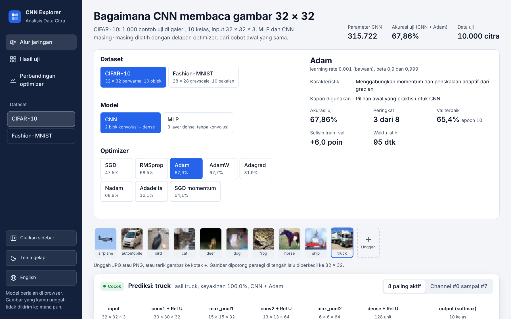
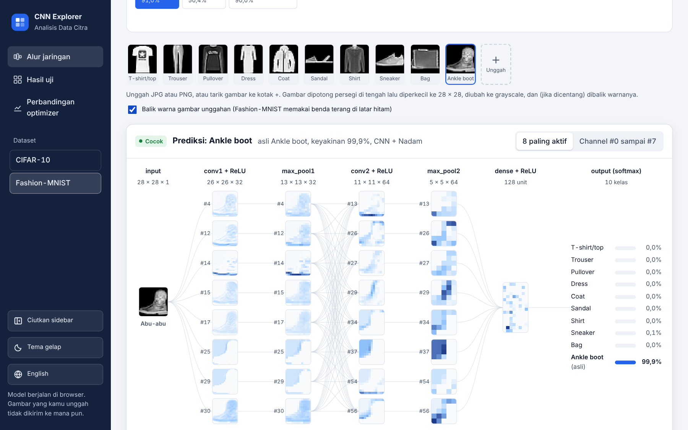
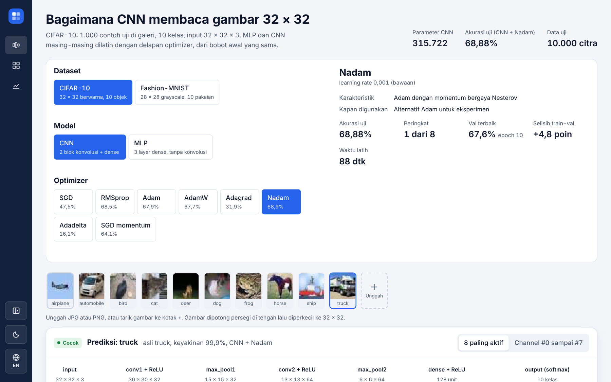

# CNN Optimizer Explorer

[English](README.md) | **Bahasa Indonesia**

Halaman web interaktif yang membuka isi sebuah *convolutional neural network* (CNN) kecil dan memperlihatkan apa yang dilakukannya terhadap gambar, layer demi layer. Kamu bisa berpindah antara dua dataset (foto CIFAR-10 dan pakaian Fashion-MNIST), dua arsitektur (CNN dan MLP biasa), dan delapan optimizer, mengunggah gambar sendiri, dan melihat di mana model menebak dengan benar maupun salah.

**Dashboard langsung: https://febrianggi.github.io/CNN-Implementer/dashboard/index.id.html**

Semuanya berjalan di browser-mu. Tidak ada server, dan gambar yang kamu unggah tidak keluar dari komputermu.



## Untuk apa ini?

CNN biasanya dijelaskan dengan diagram kotak dan panah. Halaman ini memperlihatkan wujud aslinya: feature map dan kernel dari model yang benar-benar dilatih, dihitung langsung untuk gambar yang kamu pilih. Halaman ini dibuat untuk mahasiswa dan siapa saja yang sedang belajar cara kerja CNN, dan menjawab tiga pertanyaan:

- **Apa yang dilakukan setiap layer terhadap gambar?** Ikuti satu gambar dari channel warnanya sampai probabilitas kelas di akhir.
- **Apakah optimizer berpengaruh?** Jaringan yang sama dilatih delapan kali, sekali per optimizer, dari bobot awal yang identik. Ganti-ganti optimizer lalu bandingkan.
- **Apakah konvolusi berpengaruh?** Data dan optimizer yang sama juga dipakai melatih MLP tanpa konvolusi sama sekali, jadi kamu bisa membandingkannya dengan CNN gambar demi gambar.
- **Apakah dataset berpengaruh?** Arsitektur yang sama dilatih pada gambar pakaian grayscale yang mudah dan foto berwarna yang lebih sulit.

Tata letak tampilan jaringannya terinspirasi dari [CNN Explainer](https://poloclub.github.io/cnn-explainer/).

## Cara memakai dashboard

Halaman ini punya tiga bagian yang bisa dibuka dari sidebar: **Alur jaringan**, **Hasil uji**, dan **Perbandingan optimizer**. Kontrol di bagian atas berlaku untuk ketiganya.

1. **Pilih dataset.** CIFAR-10 (foto berwarna 32 × 32 berisi pesawat, kucing, truk, dan lainnya) atau Fashion-MNIST (gambar grayscale 28 × 28 berisi kemeja, sepatu kets, tas, dan lainnya). Pilihan ini juga ada di sidebar.
2. **Pilih model.** *CNN* (dua blok konvolusi, lalu layer dense) atau *MLP* (tiga layer dense, tanpa konvolusi). Dengan MLP, alur menampilkan gambar yang diratakan menjadi satu vektor panjang lalu melewati dua layer dense.
3. **Pilih optimizer.** Kartu di samping tombol menjelaskan cara optimizer itu memperbarui bobot, kapan biasanya dipakai, dan seberapa baik hasilnya dengan model yang dipilih.
4. **Pilih gambar.** Klik salah satu dari sepuluh gambar contoh, atau tekan **+** untuk mengunggah JPG atau PNG sendiri (bisa juga dengan menyeret berkas ke kotaknya). Gambar unggahan dipotong persegi di tengah dan diperkecil sesuai ukuran dataset. Untuk Fashion-MNIST, gambar juga diubah ke grayscale dan secara bawaan dibalik warnanya, karena Fashion-MNIST menampilkan benda terang di latar hitam.
5. **Baca alur jaringan dari kiri ke kanan.**
   - **input**: channel warna gambar (merah, hijau, biru untuk CIFAR-10; satu channel abu-abu untuk Fashion-MNIST).
   - **conv1** dan **conv2** (CNN): setiap kotak adalah *feature map*, keluaran dari satu filter 3 × 3 hasil latihan. Area terang adalah tempat filter itu menemukan polanya. Hanya 8 dari 32 atau 64 peta yang ditampilkan; pilih "8 paling aktif" atau "Channel #0 sampai #7".
   - **max_pool** (CNN): mengambil nilai terkuat di setiap blok 2 × 2, sehingga ukurannya jadi setengah.
   - **flatten** (MLP): semua nilai piksel dalam satu vektor panjang. Mulai dari sini model tidak lagi tahu piksel mana yang bersebelahan.
   - **dense**: layer berisi unit yang masing-masing menggabungkan semua inputnya; layer terakhir merangkum gambar dalam 128 angka.
   - **output**: probabilitas setiap kelas dari 10 kelas. Label di atas alur menunjukkan apakah prediksi teratas cocok dengan kelas aslinya.
6. **Klik kotak mana pun** untuk memperbesarnya. Untuk feature map CNN, kamu melihat bobot kernel yang menghasilkannya (merah negatif, biru positif). Untuk *dense1* pada MLP, kamu melihat bobot masuk unit paling aktif yang disusun kembali menjadi gambar: pola yang dicari unit itu.
7. **Bandingkan semua optimizer pada satu gambar.** Tombol "Bandingkan semua optimizer" menampilkan prediksi dan keyakinan setiap optimizer untuk gambar yang sedang dilihat. Klik salah satu kartu untuk berpindah ke optimizer itu.
8. **Telusuri hasil uji.** Kumpulan tetap 1.000 citra uji (100 per kelas); setiap kartu menampilkan label asli, prediksi, keyakinan, dan label *Cocok* atau *Tidak cocok*. Filter berdasarkan status dan kelas, misalnya "truck" + "Tidak cocok". Pilih optimizer kedua di *Pembanding* lalu centang *Hanya yang statusnya berbeda* untuk menemukan gambar yang hasilnya berbeda antara dua optimizer. Klik kartu untuk memeriksanya di alur jaringan.
9. **Bandingkan optimizer.** Tabel ringkasan, diagram batang akurasi uji, kurva validasi kedelapan optimizer, kurva train vs validasi, akurasi per kelas, confusion matrix, dan tabel MLP vs CNN untuk optimizer yang dipilih. Klik sel confusion matrix untuk membuka kesalahan-kesalahan itu di galeri.

Sidebar berisi tautan ke tiap bagian dan pilihan dataset. *Ciutkan sidebar* mengecilkannya menjadi ikon agar alur jaringan lebih lega, dan ada juga tombol tema terang/gelap serta tombol bahasa Inggris/Indonesia.

| Satu gambar, delapan optimizer | Mencari perbedaan hasil di data uji |
|---|---|
|  |  |

| MLP: flatten, lalu layer dense | Fashion-MNIST di alur jaringan |
|---|---|
|  |  |

| Perbandingan optimizer | Sidebar diciutkan menjadi ikon |
|---|---|
|  |  |

## Cara kerjanya

Model dilatih sekali di Python, lalu halaman menjalankannya dengan JavaScript:

```
Python (TensorFlow / Keras)                         Browser (GitHub Pages)
───────────────────────────                         ──────────────────────
src/train.py                                        dashboard/index.id.html
  melatih MLP dan CNN, masing-masing 8 optimizer      memuat data.json untuk dataset terpilih
        │                                             memuat w-<model>-<optimizer>.json saat dibutuhkan
        ▼                                             menjalankan model dengan JavaScript biasa:
models/<dataset>/*.keras  (ikut di repo ini)            CNN: conv → ReLU → max pool → conv → ReLU
        │                                                    → max pool → dense → softmax
        ▼                                               MLP: flatten → dense → dense → softmax
src/export_dashboard.py                               menggambar setiap hasil antara
  menulis dashboard/data/<dataset>/
    data.json                  citra uji, prediksi, confusion matrix, kurva training
    w-<model>-<optimizer>.json bobot (float 16-bit, sekitar 0,5 sampai 2 MB per berkas)
```

- **Tanpa server.** Dashboard ini halaman statis dengan berkas JSON di sampingnya, jadi GitHub Pages bisa langsung menayangkannya.
- **Browser yang menghitung.** Forward pass ditulis ulang dalam beberapa puluh baris JavaScript. Probabilitasnya sama dengan Keras dengan selisih di bawah 0,000001 untuk bobot yang sama.
- **Bobot ringan.** Bobot disimpan sebagai float 16-bit. Semua angka di halaman (akurasi, confusion matrix, prediksi galeri) dihitung ulang dari bobot yang sudah dibulatkan itu, jadi halaman dan berkasnya selalu sesuai.
- **Unggahan tetap lokal.** Gambar unggahan dibaca dengan canvas browser dan tidak dikirim ke mana pun.

## Model

Kedua arsitektur sama untuk kedua dataset; yang berubah hanya ukuran input.

**CNN**

| Layer | Output CIFAR-10 | Output Fashion-MNIST | Parameter (CIFAR-10 / Fashion-MNIST) |
|---|---|---|---|
| Input | 32 × 32 × 3 | 28 × 28 × 1 | |
| Conv2D, 32 filter 3 × 3, ReLU | 30 × 30 × 32 | 26 × 26 × 32 | 896 / 320 |
| MaxPooling 2 × 2 | 15 × 15 × 32 | 13 × 13 × 32 | |
| Conv2D, 64 filter 3 × 3, ReLU | 13 × 13 × 64 | 11 × 11 × 64 | 18.496 / 18.496 |
| MaxPooling 2 × 2 | 6 × 6 × 64 | 5 × 5 × 64 | |
| Flatten | 2.304 | 1.600 | |
| Dense 128, ReLU, Dropout 0,3 | 128 | 128 | 295.040 / 204.928 |
| Dense 10, softmax | 10 | 10 | 1.290 / 1.290 |
| **Total** | | | **315.722 / 225.034** |

**MLP**

| Layer | Output CIFAR-10 | Output Fashion-MNIST | Parameter (CIFAR-10 / Fashion-MNIST) |
|---|---|---|---|
| Flatten | 3.072 | 784 | |
| Dense 256, ReLU | 256 | 256 | 786.688 / 200.960 |
| Dense 128, ReLU | 128 | 128 | 32.896 / 32.896 |
| Dense 10, softmax | 10 | 10 | 1.290 / 1.290 |
| **Total** | | | **820.874 / 235.146** |

Pengaturan training untuk setiap run: seed 42 (bobot awal identik), 10 epoch, batch 128, 10% data latih untuk validasi, learning rate bawaan Keras kecuali run tambahan *SGD + momentum* (learning rate 0,05, momentum 0,9, Nesterov).

## Hasil

Akurasi pada 10.000 citra uji masing-masing dataset.

### CIFAR-10

| Optimizer | Akurasi uji CNN | Akurasi uji MLP | CNN − MLP |
|---|---|---|---|
| Nadam | 68,88% | 48,17% | +20,71 poin |
| RMSprop | 68,53% | 43,08% | +25,45 poin |
| Adam | 67,86% | 46,87% | +20,99 poin |
| AdamW | 67,74% | 48,20% | +19,54 poin |
| SGD + momentum | 64,10% | 43,99% | +20,11 poin |
| SGD | 47,48% | 43,47% | +4,01 poin |
| Adagrad | 31,93% | 38,58% | −6,65 poin |
| Adadelta | 16,07% | 30,69% | −14,62 poin |

### Fashion-MNIST

| Optimizer | Akurasi uji CNN | Akurasi uji MLP | CNN − MLP |
|---|---|---|---|
| RMSprop | 91,04% | 87,43% | +3,61 poin |
| Adam | 91,03% | 87,29% | +3,74 poin |
| Nadam | 90,96% | 87,72% | +3,24 poin |
| AdamW | 90,61% | 86,62% | +3,99 poin |
| SGD + momentum | 89,97% | 87,46% | +2,51 poin |
| SGD | 81,63% | 84,28% | −2,65 poin |
| Adagrad | 73,82% | 80,03% | −6,21 poin |
| Adadelta | 50,41% | 66,55% | −16,14 poin |

Loss uji, akurasi validasi terbaik, selisih train−validasi, dan waktu latih untuk ke-32 run ada di [`results/`](results/).

Yang menonjol:

- **Optimizer adaptif berakhir berdekatan.** Untuk CNN, Adam, AdamW, Nadam, dan RMSprop berakhir dalam rentang sekitar satu poin di kedua dataset. Dengan satu run per optimizer, selisih sekecil itu bukan bukti bahwa salah satunya lebih baik.
- **Learning rate bawaan berpengaruh.** SGD, Adagrad, dan Adadelta memakai learning rate bawaan yang kecil dan masih jauh dari konvergen setelah 10 epoch. Memberi SGD momentum dan learning rate lebih besar menutup sebagian besar ketertinggalannya.
- **CNN paling membantu pada gambar yang lebih sulit.** Dengan Adam, CNN mengungguli MLP 21,0 poin di CIFAR-10 dengan parameter kurang dari setengahnya. Di Fashion-MNIST selisihnya hanya 3,7 poin, karena siluet pakaian di tengah latar hitam sudah mudah bagi MLP.
- **Keunggulan CNN butuh optimizer yang benar-benar melatihnya.** Dengan nilai bawaan yang lambat, urutannya terbalik: MLP mengungguli CNN dengan Adagrad dan Adadelta di kedua dataset, dan dengan SGD biasa di Fashion-MNIST. Dalam 10 epoch dengan learning rate sekecil itu, CNN belum cukup belajar.


## Data

| Dataset | Link | Dipakai di sini |
|---|---|---|
| CIFAR-10 | https://www.cs.toronto.edu/~kriz/cifar.html | 60.000 citra berwarna, 32 × 32, 10 kelas (50.000 latih, 10.000 uji) |
| CIFAR-10 dalam bentuk berkas gambar | https://github.com/YoongiKim/CIFAR-10-images | Salinan yang dipakai melatih model CIFAR-10 di dashboard |
| Fashion-MNIST | https://github.com/zalandoresearch/fashion-mnist | 70.000 citra grayscale, 28 × 28, 10 kelas (60.000 latih, 10.000 uji) |

Model CIFAR-10 di dashboard dilatih dengan salinan berkas JPG, yang pikselnya sedikit berbeda dari versi biner resmi karena kompresi JPG. Melatih dengan data resmi akan memberi angka yang sedikit berbeda.

Sitasi:
- Alex Krizhevsky. *Learning Multiple Layers of Features from Tiny Images*. 2009.
- Han Xiao, Kashif Rasul, Roland Vollgraf. *Fashion-MNIST: a Novel Image Dataset for Benchmarking Machine Learning Algorithms*. arXiv:1708.07747, 2017.

## Struktur repositori

```
.
├── index.html                  mengarahkan pengunjung GitHub Pages ke dashboard
├── dashboard/
│   ├── index.html              dashboard (bahasa Inggris)
│   ├── index.id.html           dashboard (bahasa Indonesia)
│   └── data/
│       ├── summary.json        akurasi MLP vs CNN untuk kedua dataset
│       ├── cifar10/            data.json + w-<model>-<optimizer>.json
│       └── fashion/            data.json + w-<model>-<optimizer>.json
├── models/
│   ├── cifar10/                <model>-<optimizer>.keras + .history.json (16 model hasil latihan)
│   └── fashion/                <model>-<optimizer>.keras + .history.json (16 model hasil latihan)
├── src/
│   ├── train.py                melatih MLP dan CNN dengan 8 optimizer untuk satu dataset
│   └── export_dashboard.py     mengubah model hasil latihan menjadi dashboard/data/<dataset>/
├── notebooks/
│   └── cnn_optimizers.ipynb    training yang sama, langkah demi langkah dengan penjelasan
├── results/                    tabel hasil dan riwayat training
├── docs/screenshots/           gambar untuk README ini
└── requirements.txt
```

## Menjalankan sendiri

### Membuka dashboard di komputermu

Halaman ini memuat datanya dengan `fetch`, yang diblokir browser untuk berkas yang dibuka langsung dari disk. Jalankan web server kecil:

```bash
cd dashboard
python -m http.server 8000
```

Lalu buka http://localhost:8000/index.id.html (Indonesia) atau http://localhost:8000 (Inggris).

### Menayangkan salinanmu sendiri dengan GitHub Pages

1. Fork atau push repositori ini ke GitHub.
2. Buka **Settings → Pages**, atur **Source** ke *Deploy from a branch*, lalu pilih branch `main` dan folder `/ (root)`.
3. Sekitar satu menit kemudian situsnya aktif di `https://<username>.github.io/<nama-repositori>/`. Berkas `index.html` di root meneruskan pengunjung ke dashboard.

### Melatih ulang model

```bash
pip install -r requirements.txt

python src/train.py --dataset cifar10        # 16 run, sekitar 20 menit di CPU laptop
python src/export_dashboard.py --dataset cifar10

python src/train.py --dataset fashion        # 16 run, sekitar 15 menit di CPU laptop
python src/export_dashboard.py --dataset fashion
```

Kedua skrip mengunduh data lewat `keras.datasets` secara bawaan. Untuk memakai salinan lokal, tambahkan `--source files --data-dir <folder>` (salinan berkas gambar CIFAR-10, atau empat berkas `.gz` dari repositori Fashion-MNIST). Pakai `--models mlp` atau `--models cnn` untuk melatih satu arsitektur saja, dan `--epochs 1 --limit 2000` untuk uji cepat.

### Memakai model hasil latihan

Ke-32 model di balik dashboard ada di [`models/`](models/), disimpan sebagai bobot tanpa state optimizer (sekitar 1 sampai 3 MB per berkas). Setiap model disertai `.history.json` berisi kurva training per epoch, akurasi uji, dan waktu latih.

```python
import keras
model = keras.models.load_model("models/cifar10/cnn-adam.keras")
model.summary()
```

Input harus diskalakan ke 0–1 dengan bentuk `(N, 32, 32, 3)` untuk CIFAR-10 atau `(N, 28, 28, 1)` untuk Fashion-MNIST.

### Mengikuti lewat notebook

[`notebooks/cnn_optimizers.ipynb`](notebooks/cnn_optimizers.ipynb) menjalankan analisis yang sama langkah demi langkah, dengan penjelasan di setiap langkah: eksplorasi data, membangun model, cek manual jumlah parameter, evaluasi CNN, dan eksperimen optimizer untuk MLP maupun CNN. Atur `DATASET = "cifar10"` atau `"fashion"` di sel kode pertama. Penjelasan utamanya bahasa Inggris, masing-masing dengan terjemahan bahasa Indonesia yang bisa dibuka.

Untuk membukanya di Google Colab: **File → Open notebook → GitHub**, tempel URL repositori ini, lalu pilih notebook-nya. Pakai runtime GPU (*Runtime → Change runtime type → T4 GPU*); satu run penuh butuh sekitar 10 menit per dataset.

Versi yang dipakai: Python 3.13, TensorFlow 2.21, Keras 3.15, NumPy 2.5, Pillow 12.3.

## Keterbatasan

- Setiap optimizer dilatih satu kali dengan satu seed. Selisih sekitar satu poin antar optimizer masih dalam rentang variasi antar run.
- Semua run berhenti di epoch 10. Optimizer yang lebih baik masih terus membaik di epoch terakhir, jadi training lebih lama akan menaikkan semua angka.
- Gambar unggahanmu dinilai oleh model yang hanya mengenal 10 kelas dari dataset terpilih pada resolusi sangat rendah. Foto anjing yang tidak memenuhi bingkai sering salah dibaca.

## Pembuat

Febrianggi Caesar Immanuel, Statistika, Universitas Padjadjaran. GitHub: [@Febrianggi](https://github.com/Febrianggi)
