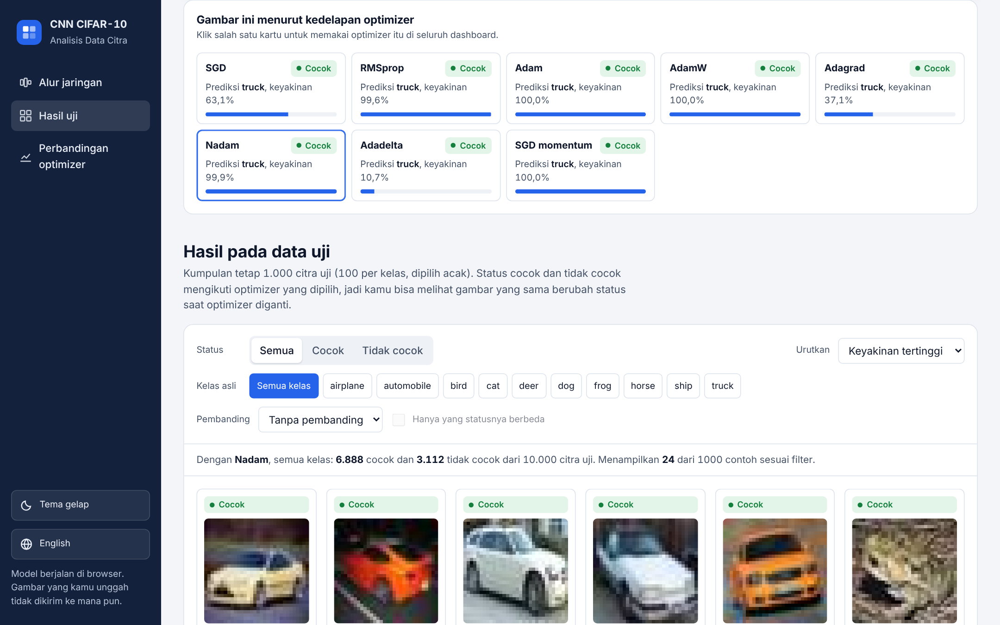
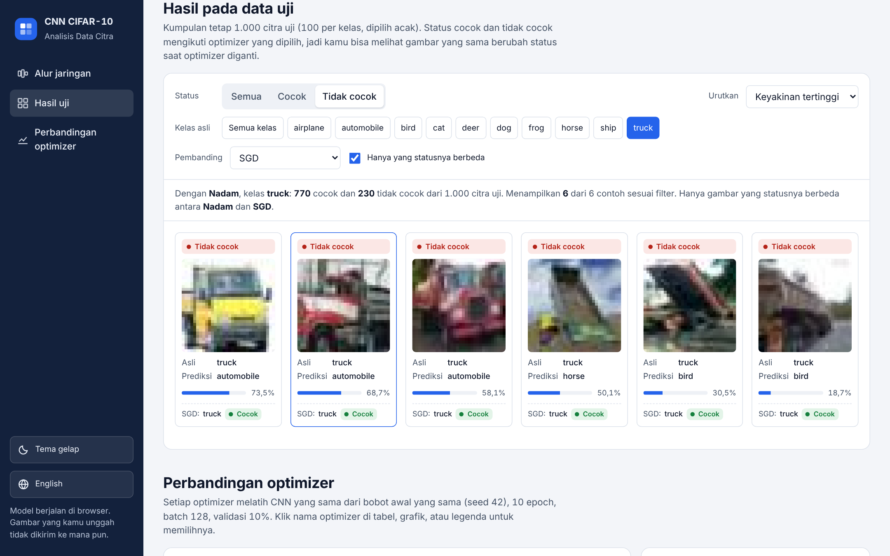
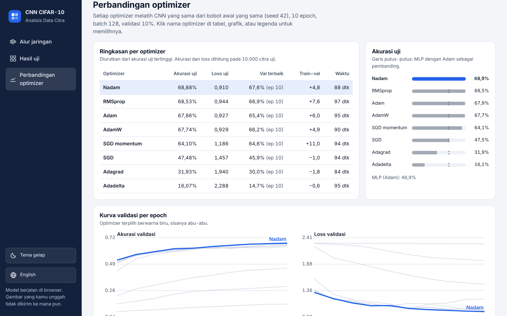

# CNN CIFAR-10 Optimizer Explorer

[English](README.md) | **Bahasa Indonesia**

Dashboard interaktif yang memperlihatkan bagaimana CNN kecil membaca gambar CIFAR-10 berukuran 32 × 32, dan bagaimana pilihan optimizer mengubah apa yang dipelajarinya. Satu arsitektur CNN dilatih delapan kali, sekali untuk tiap optimizer. Kamu bisa berpindah di antara delapan model itu dan melihat feature map, kernel, prediksi, serta hasil uji ikut berubah.

Tampilan alur jaringannya terinspirasi dari [CNN Explainer](https://poloclub.github.io/cnn-explainer/). Proyek ini membuat tampilan serupa untuk model dari praktikum mata kuliah Analisis Data Citra.


## Fitur

- **Alur jaringan**: input (channel R, G, B), conv1, max_pool1, conv2, max_pool2, dense, dan output softmax, dihubungkan seperti di CNN Explainer. Klik feature map mana pun untuk melihat nilai dan bobot kernelnya.
- **Kontrol optimizer**: pilih SGD, RMSprop, Adam, AdamW, Adagrad, Nadam, Adadelta, atau SGD dengan momentum. Alur, galeri, dan statistik semuanya mengikuti optimizer yang dipilih.
- **Unggah gambar sendiri**: JPG atau PNG apa pun dipotong persegi di tengah, diperkecil ke 32 × 32, lalu diklasifikasikan langsung di browser. Tidak ada yang dikirim ke server.
- **Satu gambar, delapan optimizer**: prediksi semua optimizer untuk gambar yang sedang dilihat, berdampingan.
- **Galeri hasil uji**: label asli, prediksi, dan keyakinan di setiap kartu, dengan label *Cocok* atau *Tidak cocok* di atas gambar. Bisa difilter berdasarkan status (cocok / tidak cocok) dan kelas asli, serta dibandingkan dengan optimizer kedua untuk mencari gambar yang hasilnya berbeda.
- **Perbandingan optimizer**: tabel ringkasan, diagram batang akurasi uji, kurva validasi, kurva train vs validasi, akurasi per kelas, dan confusion matrix yang bisa diklik.
- Versi bahasa Inggris dan Indonesia, tema terang dan gelap, bisa dipakai dengan keyboard, dan berfungsi di ponsel.

| Satu gambar menurut semua optimizer | Filter cocok dan perbedaan hasil |
|---|---|
|  |  |

| Perbandingan optimizer | Detail feature map dan kernel |
|---|---|
|  |  |

## Hasil

CNN yang sama, bobot awal yang sama (seed 42), 10 epoch, batch 128, validasi 10%, learning rate bawaan Keras (kecuali run tambahan SGD + momentum). Akurasi diukur pada 10.000 citra uji CIFAR-10.

| Model | Optimizer | Akurasi uji | Loss uji | Akurasi val terbaik (epoch) | Selisih train−val |
|---|---|---|---|---|---|
| CNN | Nadam | 68,88% | 0,910 | 67,56% (10) | +4,8 poin |
| CNN | RMSprop | 68,53% | 0,944 | 66,86% (10) | +7,6 poin |
| CNN | Adam | 67,86% | 0,927 | 65,44% (10) | +6,0 poin |
| CNN | AdamW | 67,74% | 0,929 | 66,24% (10) | +4,9 poin |
| CNN | SGD + momentum (lr 0,05) | 64,10% | 1,186 | 64,64% (10) | +11,0 poin |
| CNN | SGD | 47,48% | 1,457 | 45,92% (10) | −1,0 poin |
| CNN | Adagrad | 31,93% | 1,940 | 30,02% (10) | −1,8 poin |
| CNN | Adadelta | 16,07% | 2,288 | 14,74% (10) | −0,6 poin |
| MLP | Adam | 46,87% | | | |

Yang bisa dibaca dari angka-angka ini:

- Keluarga Adam dan RMSprop berakhir dalam rentang 1,2 poin satu sama lain. Dengan satu seed, selisih sekecil itu belum cukup untuk menyebut salah satunya lebih baik.
- SGD, Adagrad, dan Adadelta tertinggal jauh karena learning rate bawaannya terlalu kecil untuk 10 epoch. SGD dengan momentum dan learning rate lebih besar menutup sebagian besar ketertinggalan itu, tetapi selisih train−val-nya juga paling besar.
- CNN mengungguli MLP sekitar 21 poin di CIFAR-10 dengan parameter kurang dari setengahnya (315.722 vs 820.874). Di Fashion-MNIST, perbandingan yang sama hanya berselisih 3,4 poin (91,01% vs 87,61%). Konvolusi jauh lebih membantu pada citra berwarna dengan latar yang beragam.

Angka lengkap ada di [`results/optimizer_results.csv`](results/optimizer_results.csv) dan riwayat per epoch di [`results/training_history.json`](results/training_history.json).

## Data

| Dataset | Link | Dipakai untuk |
|---|---|---|
| CIFAR-10 (resmi) | https://www.cs.toronto.edu/~kriz/cifar.html | Dataset sumber: 60.000 citra berwarna 32 × 32, 10 kelas (50.000 latih, 10.000 uji) |
| CIFAR-10 dalam bentuk berkas gambar | https://github.com/YoongiKim/CIFAR-10-images | Salinan yang dipakai untuk melatih model di repositori ini |
| Fashion-MNIST | https://github.com/zalandoresearch/fashion-mnist | Angka pembanding MLP vs CNN dari notebook praktikum |

Model di `dashboard/` dilatih dengan salinan CIFAR-10 berbentuk berkas JPG, bukan batch biner resmi. Kompresi JPG sedikit mengubah nilai piksel, jadi melatih ulang dengan data resmi (`--source keras`) akan memberi angka yang sedikit berbeda.

Sitasi CIFAR-10: Alex Krizhevsky, *Learning Multiple Layers of Features from Tiny Images*, 2009.

## Model

```
Input (32, 32, 3)
Conv2D 32 filter 3×3, ReLU       ->  30 × 30 × 32      896 parameter
MaxPooling2D 2×2                 ->  15 × 15 × 32
Conv2D 64 filter 3×3, ReLU       ->  13 × 13 × 64   18.496 parameter
MaxPooling2D 2×2                 ->   6 ×  6 × 64
Flatten                          ->  2.304
Dense 128, ReLU                  ->  128           295.040 parameter
Dropout 0,3
Dense 10, softmax                ->  10              1.290 parameter
Total                                              315.722 parameter
```

## Struktur repositori

```
.
├── dashboard/
│   ├── index.html          dashboard bahasa Inggris (bawaan)
│   ├── index.id.html       dashboard bahasa Indonesia
│   ├── data.json           atlas citra uji, prediksi, confusion matrix, riwayat training
│   └── w-<optimizer>.json  bobot CNN per optimizer (float16, base64)
├── src/
│   ├── train.py            melatih MLP dan CNN dengan kedelapan optimizer
│   └── export_dashboard.py mengekspor model hasil latihan ke dashboard/
├── notebooks/
│   └── cifar10_cnn_optimizers.ipynb  kode training lengkap dengan penjelasan (bahasa Inggris, terjemahan Indonesia bisa dibuka)
├── results/                tabel hasil dan riwayat training
├── docs/screenshots/       screenshot untuk README
├── index.html              mengarahkan ke dashboard/ (untuk GitHub Pages)
└── requirements.txt
```

## Menjalankan dashboard

Dashboard ini halaman statis, tetapi memuat `data.json` dan berkas bobot lewat `fetch`, jadi harus dibuka lewat HTTP. Membuka `index.html` langsung dari disk akan menampilkan pesan gagal memuat.

```bash
cd dashboard
python -m http.server 8000
# buka http://localhost:8000/index.id.html   (Indonesia)
# buka http://localhost:8000                 (Inggris)
```

### Publikasi dengan GitHub Pages

1. Push folder ini ke repositori GitHub.
2. Buka **Settings → Pages**, atur **Source** ke *Deploy from a branch*, pilih `main` dan `/ (root)`.
3. Situsnya ada di `https://<username>.github.io/<repositori>/`. Berkas `index.html` di root akan mengarahkan ke dashboard.

## Notebook

[`notebooks/cifar10_cnn_optimizers.ipynb`](notebooks/cifar10_cnn_optimizers.ipynb) menjalankan seluruh analisis dengan penjelasan di setiap langkah: memuat dan mengeksplorasi CIFAR-10, MLP dan CNN, cek manual jumlah parameter, evaluasi dengan confusion matrix, pembanding Fashion-MNIST, eksperimen delapan optimizer, dan menyimpan model untuk dashboard.

Penjelasan utamanya dalam bahasa Inggris. Setiap penjelasan punya terjemahan bahasa Indonesia di bagian **Bahasa Indonesia** yang bisa dibuka-tutup, dan ini berfungsi di GitHub maupun Google Colab.

Untuk menjalankannya di Colab: **File → Open notebook → GitHub**, tempel URL repositori ini, lalu pilih notebook-nya. Pilih runtime GPU (*Runtime → Change runtime type → T4 GPU*); run penuh butuh sekitar 10 menit. Ubah `QUICK_RUN = True` di sel kode pertama untuk cek cepat sekitar satu menit.

## Melatih ulang model

```bash
pip install -r requirements.txt

# Opsi A: CIFAR-10 resmi lewat keras.datasets (mengunduh sekitar 170 MB)
python src/train.py
python src/export_dashboard.py

# Opsi B: salinan berkas gambar yang dipakai untuk dashboard ini
git clone --depth 1 https://github.com/YoongiKim/CIFAR-10-images data/CIFAR-10-images
python src/train.py --source jpg --jpg-dir data/CIFAR-10-images
python src/export_dashboard.py --source jpg --jpg-dir data/CIFAR-10-images
```

Melatih kesembilan run butuh sekitar 15 menit di CPU laptop dan beberapa menit di GPU Colab. Pakai `--epochs 1 --limit 2000` untuk cek cepat bahwa semuanya berjalan. Berkas `.keras` hasil latihan disimpan di `models/`, yang diabaikan oleh git.

Versi yang dipakai: Python 3.13, TensorFlow 2.21, Keras 3.15, NumPy 2.5, Pillow 12.3.

## Catatan

- Hasil berasal dari satu kali training per optimizer dengan satu seed. Selisih kecil antar optimizer tidak bermakna secara statistik.
- Bobot disimpan dalam float16 agar tiap berkas di bawah 1 MB. Semua angka di dashboard dihitung ulang dari bobot yang sudah dibulatkan itu, dan forward pass di browser cocok dengan Keras dengan selisih probabilitas di bawah 1e-6.
- Notebook menyimpan model dengan format yang sama seperti yang dibaca `src/export_dashboard.py`, jadi hasil run di Colab juga bisa diekspor ke dashboard.

## Pembuat

Febrianggi Caesar Immanuel, Statistika, Universitas Padjadjaran. GitHub: [@Febrianggi](https://github.com/Febrianggi)
