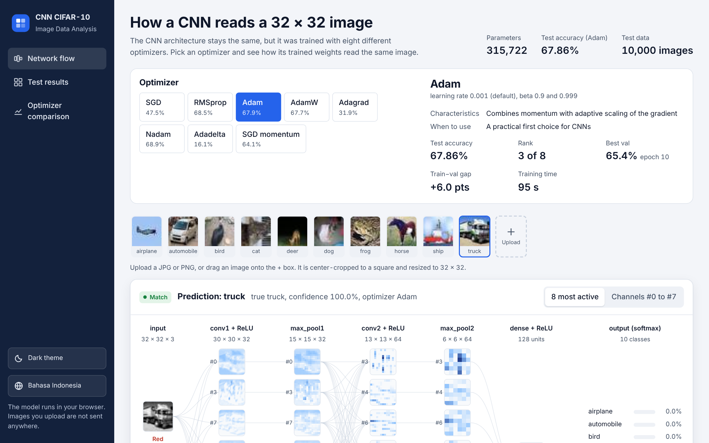

# CNN CIFAR-10 Optimizer Explorer

**English** | [Bahasa Indonesia](README.id.md)

An interactive dashboard that shows how a small convolutional neural network reads a 32 × 32 CIFAR-10 image, and how the choice of optimizer changes what it learns. One CNN architecture is trained eight times, once per optimizer. You can switch between the eight trained models and see the feature maps, kernels, predictions, and test results change with them.

The idea for the network-flow view comes from [CNN Explainer](https://poloclub.github.io/cnn-explainer/). This project builds a similar view for a model trained in an image data analysis course practicum (Analisis Data Citra).



## Features

- **Network flow**: input (R, G, B channels), conv1, max_pool1, conv2, max_pool2, dense, and softmax output, connected the way CNN Explainer draws them. Click any feature map to see its values and kernel weights.
- **Optimizer control**: switch between SGD, RMSprop, Adam, AdamW, Adagrad, Nadam, Adadelta, and SGD with momentum. The flow, gallery, and statistics all follow the selected optimizer.
- **Upload your own image**: any JPG or PNG is center-cropped, resized to 32 × 32, and classified in the browser. Nothing is uploaded to a server.
- **One image, eight optimizers**: see every optimizer's prediction for the current image side by side.
- **Test-result gallery**: true label, prediction, and confidence on each card, with a *Match* or *No match* label above the image. Filter by status (match / no match) and by true class, and compare against a second optimizer to find images where two optimizers disagree.
- **Optimizer comparison**: summary table, test-accuracy bars, validation curves, train vs validation curves, per-class accuracy, and a clickable confusion matrix.
- English and Indonesian versions, light and dark themes, keyboard accessible, works on mobile.

| Compare optimizers on one image | Filter matches and disagreements |
|---|---|
|  |  |

| Optimizer comparison | Feature map and kernel detail |
|---|---|
|  |  |

## Results

Same CNN, same initial weights (seed 42), 10 epochs, batch size 128, 10% validation split, default Keras learning rates (except the extra SGD + momentum run). Accuracy is measured on the 10,000 CIFAR-10 test images.

| Model | Optimizer | Test accuracy | Test loss | Best val accuracy (epoch) | Train−val gap |
|---|---|---|---|---|---|
| CNN | Nadam | 68.88% | 0.910 | 67.56% (10) | +4.8 pts |
| CNN | RMSprop | 68.53% | 0.944 | 66.86% (10) | +7.6 pts |
| CNN | Adam | 67.86% | 0.927 | 65.44% (10) | +6.0 pts |
| CNN | AdamW | 67.74% | 0.929 | 66.24% (10) | +4.9 pts |
| CNN | SGD + momentum (lr 0.05) | 64.10% | 1.186 | 64.64% (10) | +11.0 pts |
| CNN | SGD | 47.48% | 1.457 | 45.92% (10) | −1.0 pts |
| CNN | Adagrad | 31.93% | 1.940 | 30.02% (10) | −1.8 pts |
| CNN | Adadelta | 16.07% | 2.288 | 14.74% (10) | −0.6 pts |
| MLP | Adam | 46.87% | | | |

What the numbers say:

- The four Adam-family and RMSprop runs finish within 1.2 points of each other. With a single seed, that gap is too small to call any of them better.
- SGD, Adagrad, and Adadelta lag far behind because their default learning rates are too small to make progress in 10 epochs. SGD with momentum and a larger learning rate closes most of the gap, but it also shows the largest train−val gap.
- The CNN beats the MLP by about 21 points on CIFAR-10 while using fewer than half the parameters (315,722 vs 820,874). On Fashion-MNIST the same comparison gave only a 3.4-point gap (91.01% vs 87.61%), so convolution helps much more on color images with varied backgrounds.

Full numbers are in [`results/optimizer_results.csv`](results/optimizer_results.csv) and per-epoch histories in [`results/training_history.json`](results/training_history.json).

## Data

| Dataset | Link | Used for |
|---|---|---|
| CIFAR-10 (official) | https://www.cs.toronto.edu/~kriz/cifar.html | Source dataset: 60,000 color images, 32 × 32, 10 classes (50,000 train, 10,000 test) |
| CIFAR-10 as image files | https://github.com/YoongiKim/CIFAR-10-images | The copy used to train the models in this repository |
| Fashion-MNIST | https://github.com/zalandoresearch/fashion-mnist | MLP vs CNN reference numbers from the course notebook |

The models in `dashboard/` were trained on the image-file copy of CIFAR-10 (JPG files), not the official binary batches. JPG compression changes pixel values slightly, so retraining on the official data with `--source keras` gives slightly different numbers.

CIFAR-10 citation: Alex Krizhevsky, *Learning Multiple Layers of Features from Tiny Images*, 2009.

## Model

```
Input (32, 32, 3)
Conv2D 32 filters 3×3, ReLU      ->  30 × 30 × 32      896 params
MaxPooling2D 2×2                 ->  15 × 15 × 32
Conv2D 64 filters 3×3, ReLU      ->  13 × 13 × 64   18,496 params
MaxPooling2D 2×2                 ->   6 ×  6 × 64
Flatten                          ->  2,304
Dense 128, ReLU                  ->  128           295,040 params
Dropout 0.3
Dense 10, softmax                ->  10              1,290 params
Total                                              315,722 params
```

## Repository structure

```
.
├── dashboard/
│   ├── index.html          English dashboard (default)
│   ├── index.id.html       Indonesian dashboard
│   ├── data.json           test-image atlas, predictions, confusion matrices, histories
│   └── w-<optimizer>.json  CNN weights per optimizer (float16, base64)
├── src/
│   ├── train.py            trains the MLP and the CNN with all eight optimizers
│   └── export_dashboard.py exports trained models into dashboard/
├── notebooks/
│   └── cifar10_cnn_optimizers.ipynb  full training code with explanations (English, Indonesian in collapsible sections)
├── results/                results table and training histories
├── docs/screenshots/       screenshots used in the READMEs
├── index.html              redirects to dashboard/ (for GitHub Pages)
└── requirements.txt
```

## Run the dashboard

The dashboard is a static page, but it loads `data.json` and the weight files with `fetch`, so it must be served over HTTP. Opening `index.html` directly from disk will show a loading error.

```bash
cd dashboard
python -m http.server 8000
# open http://localhost:8000          (English)
# open http://localhost:8000/index.id.html   (Indonesian)
```

### Publish with GitHub Pages

1. Push this folder to a GitHub repository.
2. Go to **Settings → Pages**, set **Source** to *Deploy from a branch*, choose `main` and `/ (root)`.
3. The site will be at `https://<username>.github.io/<repository>/`. The root `index.html` redirects to the dashboard.

## Notebook

[`notebooks/cifar10_cnn_optimizers.ipynb`](notebooks/cifar10_cnn_optimizers.ipynb) walks through the whole analysis with an explanation under each step: loading and exploring CIFAR-10, the MLP and CNN, a hand check of the parameter count, evaluation with a confusion matrix, the Fashion-MNIST reference, the eight-optimizer experiment, and saving the models for the dashboard.

Explanations are in English. Each one has an Indonesian translation in a collapsible **Bahasa Indonesia** section, which works both on GitHub and in Google Colab.

To run it in Colab: **File → Open notebook → GitHub**, paste this repository's URL, and pick the notebook. Choose a GPU runtime (*Runtime → Change runtime type → T4 GPU*); the full run takes about 10 minutes. Set `QUICK_RUN = True` in the first code cell for a one-minute check.

## Reproduce the models

```bash
pip install -r requirements.txt

# Option A: official CIFAR-10 through keras.datasets (downloads about 170 MB)
python src/train.py
python src/export_dashboard.py

# Option B: the image-file copy used for the published dashboard
git clone --depth 1 https://github.com/YoongiKim/CIFAR-10-images data/CIFAR-10-images
python src/train.py --source jpg --jpg-dir data/CIFAR-10-images
python src/export_dashboard.py --source jpg --jpg-dir data/CIFAR-10-images
```

Training all nine runs takes about 15 minutes on a laptop CPU and a few minutes on a Colab GPU. Use `--epochs 1 --limit 2000` for a quick check that everything runs. Trained `.keras` files are written to `models/`, which is ignored by git.

Versions used: Python 3.13, TensorFlow 2.21, Keras 3.15, NumPy 2.5, Pillow 12.3.

## Notes

- Results come from one training run per optimizer with one seed. Small differences between optimizers are not statistically meaningful.
- Weights are stored in float16 to keep each file under 1 MB. Every number in the dashboard is recomputed from those rounded weights, and the in-browser forward pass matches Keras to within 1e-6 in probability.
- The notebook saves models in the same format `src/export_dashboard.py` reads, so a Colab run can be exported to the dashboard too.

## Author

Febrianggi Caesar Immanuel, Statistics, Universitas Padjadjaran. GitHub: [@Febrianggi](https://github.com/Febrianggi)
