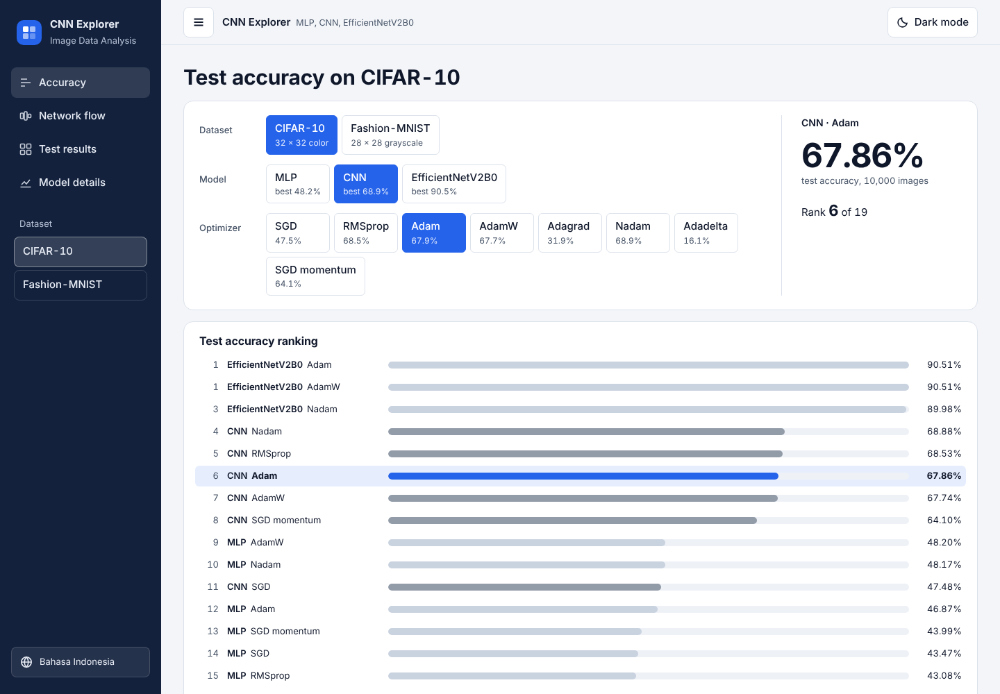
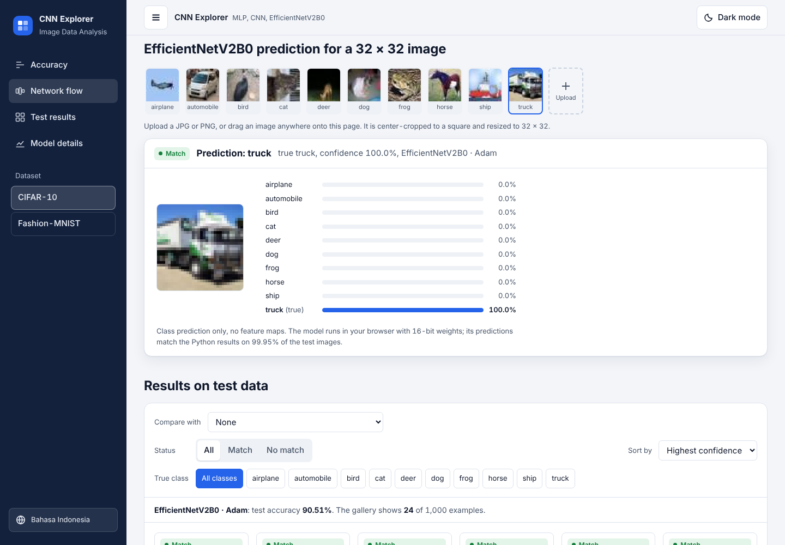
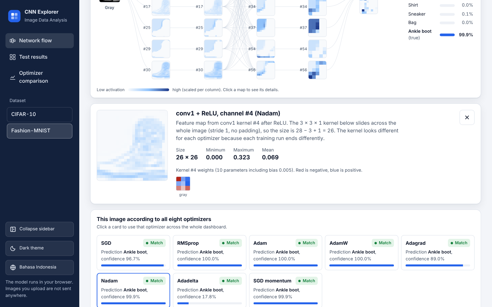
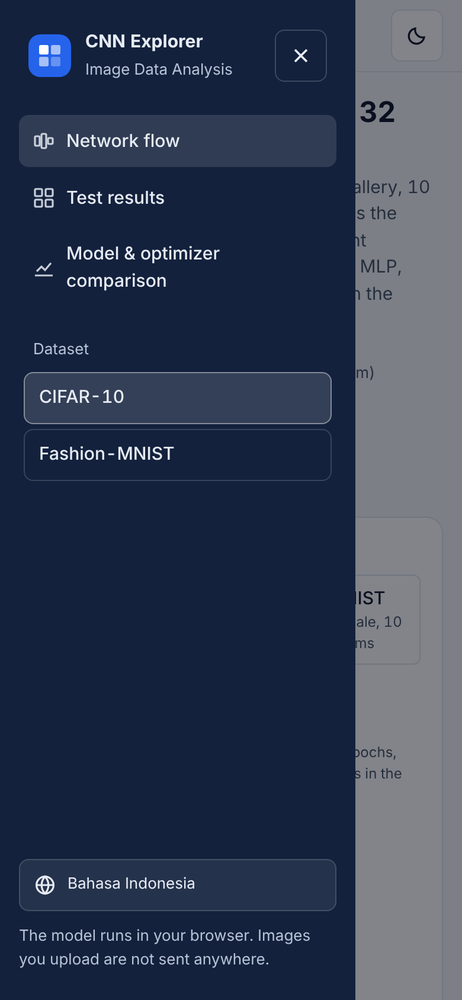

# CNN Optimizer Explorer

**English** | [Bahasa Indonesia](README.id.md)

An interactive web page that opens up a small convolutional neural network (CNN) and shows what it does with an image, layer by layer. You can switch between two datasets (CIFAR-10 photos and Fashion-MNIST clothing) and eight optimizers, upload your own picture, and see where the model gets things right and wrong. A second part compares three architectures, a plain MLP, the small CNN, and a pretrained EfficientNetV2B0, under one controlled protocol: the same data split, paired seeds, and checkpoints chosen on validation macro-F1.

**Live dashboard: https://febrianggi.github.io/CNN-Implementer/**

There is no server: the CNN runs in your browser, and nothing you upload leaves your computer. The other models' test predictions were computed in Python and are loaded from files.



## What is this for?

A CNN is often explained with diagrams of boxes and arrows. This page shows the real thing: actual feature maps and kernels from trained models, computed live for the image you choose. It is built for students and anyone learning how CNNs work, and it answers four questions:

- **What does each layer do to an image?** Follow one picture from its color channels to the final class probabilities.
- **Does the optimizer matter?** The same network was trained eight times, once per optimizer, from identical starting weights. Switch between them and compare.
- **Does convolution matter, and does pretraining?** An MLP with no convolution, the small CNN, and an ImageNet-pretrained EfficientNetV2B0 are trained on the same split with the same seeds, so you can compare them image by image.
- **Does the dataset matter?** The same architectures are trained on easy grayscale clothing images and on harder color photos.

The layout of the network view is inspired by [CNN Explainer](https://poloclub.github.io/cnn-explainer/).

## How to use the dashboard

Everything starts at the top of the page: choose a **dataset** (CIFAR-10 or Fashion-MNIST), then a **model** (MLP, CNN, or EfficientNetV2B0), then an **optimizer**. The large number next to the buttons is that model's test accuracy on all 10,000 test images, with its rank among every trained model. Every section below follows this choice. Only models that have actually been trained are listed.

The page has four sections, reachable from the sidebar. The header keeps two buttons in place: the menu button on the left opens and closes the sidebar, and **Dark mode** on the right switches the theme.

1. **Accuracy.** The ranking lists all 19 trained models of the dataset (8 MLP, 8 CNN, 3 EfficientNetV2B0) on one scale. Click a row to select that model. The note under the ranking says how each model was trained, because EfficientNetV2B0 was fine-tuned on a 3,000-image subset at 96 × 96 while MLP and CNN used the full training set.
2. **Network flow** runs the selected model in your browser. Pick one of the ten example thumbnails, press **+** to upload a JPG or PNG, or drop an image anywhere on the page. For MLP and CNN, read the flow from left to right: the input channels, then conv1 and conv2 feature maps with max pooling for the CNN (or flatten and two dense layers for the MLP), then the class probabilities. Click any square to enlarge it and see the weights behind it. "Compare all optimizers" shows each optimizer's prediction for the current image. For EfficientNetV2B0 the section shows the predicted class and all 10 probabilities, without feature maps: the model is exported to ONNX and runs with ONNX Runtime Web, and its file (about 12 MB) is downloaded the first time you use it.
3. **Test results** shows the selected model's predictions on a fixed set of 1,000 test images (100 per class). Filter by match status and true class, and optionally compare with a second model to filter by *Both right*, *Only selected right*, *Only comparison right*, or *Both wrong*. The counts in the summary line always use all 10,000 test images.
4. **Model details** shows the selected model's training curves, per-class accuracy, and confusion matrix, then a summary of every optimizer of that model with its overall rank, the validation curves of those optimizers, and a table comparing MLP, CNN, and EfficientNetV2B0 on both datasets with the selected optimizer. Click a class or an off-diagonal cell to open those images in the gallery.

On a wide screen the sidebar is open by default and the content widens when you close it. On a phone it opens as a drawer; close it with ×, Escape, a tap outside it, or by choosing a section. An English/Indonesian switch sits at the bottom of the sidebar.

| Accuracy of every trained model | EfficientNetV2B0 prediction in the browser |
|---|---|
|  |  |

| Network flow (MLP) | Test results compared with another model |
|---|---|
|  |  |

| Model details | Dark mode, phone |
|---|---|
|  |  |

## How it works

```
Python (TensorFlow / Keras)                              Browser (GitHub Pages)
───────────────────────────                              ──────────────────────
src/train.py           historical sweep:                 dashboard/index.html
  MLP and CNN × 8 optimizers, 10 epochs, seed 42           Network flow: runs the CNN in plain JavaScript
  → models/<dataset>/*.keras                                 from w-cnn-<optimizer>.json (16-bit weights)
src/export_dashboard.py                                    Test results and comparison:
  → dashboard/data/<dataset>/data.json, w-*.json             experiments.json  (small index, loaded at start)
                                                             runs/<run>.json   (one run, loaded when opened:
src/experiments.py     controlled experiments:                 10,000 predictions keyed by official test ID,
  fixed split, paired seeds, MLP / CNN / EfficientNet           confusion matrix, per-epoch curves)
  → experiments/runs/<study>/<dataset>/<model>-<opt>/seed-<s>/
src/export_experiments.py
  → dashboard/data/<dataset>/experiments.json, runs/*.json
src/check_experiments.py  re-checks splits, warm-up identity, and every metric
src/export_effnet_onnx.py  EfficientNet checkpoints → dashboard/data/<dataset>/effnet-*.onnx
  (classifies uploads in the browser; checked against all 10,000 saved test predictions)
```

- **No server.** The dashboard is a static page with JSON files beside it, so GitHub Pages can host it as is.
- **The browser does the CNN math.** The forward pass is re-implemented in about 40 lines of JavaScript. Its probabilities match Keras to within 0.000001 on the same weights.
- **Light at first load.** The page loads one dataset file, one CNN weight file, and a small run index. Predictions and curves for a run are fetched only when you open it. EfficientNet weights (about 12 MB per optimizer, 16-bit, computed in float32) are downloaded only when you classify an image with EfficientNet; its predicted class matches the Python evaluation on 99.93% to 100% of the test images, depending on the dataset and optimizer (`dashboard/data/effnet_onnx.json`).
- **Which artifact made which number.** Historical sweep numbers are recomputed from the 16-bit weights the browser runs. Controlled runs are evaluated in Python from their 32-bit checkpoints, and the page shows those saved predictions.
- **Uploads stay local.** An uploaded image is read with the browser's canvas API and never sent anywhere.

## The models

The same two architectures for both datasets; only the input size changes.

**CNN**

| Layer | CIFAR-10 output | Fashion-MNIST output | Parameters (CIFAR-10 / Fashion-MNIST) |
|---|---|---|---|
| Input | 32 × 32 × 3 | 28 × 28 × 1 | |
| Conv2D, 32 filters 3 × 3, ReLU | 30 × 30 × 32 | 26 × 26 × 32 | 896 / 320 |
| MaxPooling 2 × 2 | 15 × 15 × 32 | 13 × 13 × 32 | |
| Conv2D, 64 filters 3 × 3, ReLU | 13 × 13 × 64 | 11 × 11 × 64 | 18,496 / 18,496 |
| MaxPooling 2 × 2 | 6 × 6 × 64 | 5 × 5 × 64 | |
| Flatten | 2,304 | 1,600 | |
| Dense 128, ReLU, Dropout 0.3 | 128 | 128 | 295,040 / 204,928 |
| Dense 10, softmax | 10 | 10 | 1,290 / 1,290 |
| **Total** | | | **315,722 / 225,034** |

**MLP**

| Layer | CIFAR-10 output | Fashion-MNIST output | Parameters (CIFAR-10 / Fashion-MNIST) |
|---|---|---|---|
| Flatten | 3,072 | 784 | |
| Dense 256, ReLU | 256 | 256 | 786,688 / 200,960 |
| Dense 128, ReLU | 128 | 128 | 32,896 / 32,896 |
| Dense 10, softmax | 10 | 10 | 1,290 / 1,290 |
| **Total** | | | **820,874 / 235,146** |

Historical sweep setup: seed 42 (identical starting weights), 10 epochs, batch size 128, the last 10% of a shuffled training set held out for validation, Keras default learning rates except the extra *SGD + momentum* run (learning rate 0.05, momentum 0.9, Nesterov).

**EfficientNetV2B0** (controlled experiments only), following the recipe in [rayyanif/COVID-CT-Scans-Classification](https://github.com/rayyanif/COVID-CT-Scans-Classification) with a 10-class head:

| Step | Detail |
|---|---|
| Input | the dataset's own images as pixels 0 to 255; Fashion-MNIST's gray channel is repeated to 3 channels |
| Resize | bilinear, inside the model, to 224 × 224 (full recipe) or 96 × 96 (the small-subset runs below) |
| Augmentation | random horizontal flip, random rotation ±0.03 of a turn (training only) |
| Backbone | `keras.applications.EfficientNetV2B0`, ImageNet weights, no top, global average pooling. Its built-in preprocessing scales 0–255 pixels and applies ImageNet mean and standard deviation. BatchNorm and stochastic depth stay in inference mode throughout |
| Head | Dropout 0.4, Dense 10 softmax; loss sparse categorical cross-entropy; no class weights (classes are balanced) |
| Warm-up | backbone frozen, Adam, learning rate 0.001, 2 epochs, batch 16 |
| Fine-tuning | whole network, three independent branches from the same warm-up checkpoint, each with a fresh optimizer: Adam, AdamW (weight decay 1e-5), Nadam; learning rate 6e-5; up to 23 epochs; early stopping with patience 5 on validation macro-F1 |
| Parameters | 5,932,122 in total; 12,810 trained during warm-up |


## Controlled experiments

The historical sweep below compares optimizers with one seed and no checkpoint selection. The controlled experiments ask the architecture and training-length questions properly: the same split for every model, three paired seeds, checkpoints chosen on validation data, and the test set used only at the end.

**Status.** Everything in this section was trained on a 2-core CPU without a GPU. The MLP and CNN runs are complete (3 seeds, both datasets, both data budgets). EfficientNetV2B0 at the full recipe (224 px, full training split) was **not run**: one fine-tuning epoch takes about an hour on that CPU, and the plan needs up to 71 epochs per dataset and seed. EfficientNet was run instead on a fixed small subset at 96 px: 1 seed on CIFAR-10 and 3 seeds on Fashion-MNIST. The dashboard lists the missing runs as *not trained yet*, and the commands to run them are under [Run it yourself](#rerun-the-controlled-experiments).

### Protocol

- **Data.** Official CIFAR-10 and Fashion-MNIST files. One stratified 90/10 train/validation split per dataset ([`experiments/splits/`](experiments/splits/), split seed 2026) shared by every model, optimizer and seed. The official 10,000-image test set is untouched until evaluation.
- **Seeds 1, 2, 3, paired.** Seed *s* fixes the initial weights, the shuffling, and the dropout and augmentation streams. The three EfficientNet fine-tuning branches of a seed start from the same warm-up checkpoint (checked by weight hash) with the same random stream, so they differ only in the optimizer.
- **Selection.** The checkpoint with the highest validation macro-F1 (early stopping, patience 5). The test set is evaluated once per finished run by a separate `evaluate` step and is never used to choose anything.
- **Tuning budget: none.** One configuration per model, as specified up front. The only things chosen on validation data are the checkpoint epoch and, for EfficientNet, which fine-tuning branch to prefer.
- **MLP and CNN.** The historical architectures, Adam (learning rate 0.001), batch 128, up to 40 epochs. Each run also saves its epoch-10 weights, so *stopped at epoch 10* is a paired baseline: same split, same seed, only the training length differs. That Adam CNN at epoch 10 is the **initial CNN** every Δ below is measured against.
- **EfficientNetV2B0.** The recipe in [The models](#the-models): 2 warm-up epochs with Adam and a frozen backbone, then three fresh-optimizer branches (Adam, AdamW, Nadam).
- **Small subset.** 300 training and 150 validation images per class (3,000 and 1,500), drawn from the same split, with the same seeds. MLP and CNN were run on it too, so EfficientNet can be compared with them on equal data.
- **Recorded per run** ([`experiments/runs/`](experiments/runs/)): dataset, model, fine-tuning optimizer, seed and phase; split hashes; the warm-up hash a branch started from; input size and pretraining source; per-epoch training and validation loss and accuracy and validation macro-F1; chosen and last epoch; test predictions with official test IDs, ground truth and class order; confusion matrix, test accuracy and macro-F1. [`src/check_experiments.py`](src/check_experiments.py) recomputes all of it from the saved predictions.

### Results: full training split, 3 seeds

Mean ± standard deviation over seeds. Δ is the paired difference from the initial CNN with the same seed, in percentage points.

| Configuration | Dataset | Input | Seeds | Test accuracy (%) | Macro-F1 | Δ accuracy vs initial CNN, pp (per seed) | Chosen / run epochs |
|---|---|---|---|---|---|---|---|
| MLP, Adam, stopped at epoch 10 | CIFAR-10 | 32 px | 3 | 46.77 ± 0.56 | 0.461 ± 0.003 | −21.20 (−20.56, −21.58, −21.45) | 10/10, 10/10, 10/10 |
| MLP, Adam, early stopping | CIFAR-10 | 32 px | 3 | 49.21 ± 1.16 | 0.488 ± 0.009 | −18.75 (−17.28, −19.78, −19.20) | 30/35, 12/17, 23/28 |
| CNN, Adam, stopped at epoch 10 (**initial CNN**) | CIFAR-10 | 32 px | 3 | 67.96 ± 0.62 | 0.680 ± 0.006 | 0 | 10/10, 10/10, 10/10 |
| CNN, Adam, early stopping | CIFAR-10 | 32 px | 3 | 69.42 ± 1.19 | 0.694 ± 0.009 | +1.46 (+2.58, +0.33, +1.47) | 15/20, 12/17, 19/24 |
| EfficientNetV2B0, warm-up Adam → fine-tune Adam | CIFAR-10 | 224 px | 0 | not run | | | |
| EfficientNetV2B0, warm-up Adam → fine-tune AdamW | CIFAR-10 | 224 px | 0 | not run | | | |
| EfficientNetV2B0, warm-up Adam → fine-tune Nadam | CIFAR-10 | 224 px | 0 | not run | | | |
| MLP, Adam, stopped at epoch 10 | Fashion-MNIST | 28 px | 3 | 87.61 ± 0.46 | 0.875 ± 0.005 | −2.83 (−3.26, −3.00, −2.22) | 10/10, 10/10, 10/10 |
| MLP, Adam, early stopping | Fashion-MNIST | 28 px | 3 | 87.93 ± 0.43 | 0.878 ± 0.004 | −2.51 (−2.36, −3.00, −2.16) | 20/25, 10/15, 9/14 |
| CNN, Adam, stopped at epoch 10 (**initial CNN**) | Fashion-MNIST | 28 px | 3 | 90.43 ± 0.09 | 0.903 ± 0.002 | 0 | 10/10, 10/10, 10/10 |
| CNN, Adam, early stopping | Fashion-MNIST | 28 px | 3 | 91.15 ± 0.18 | 0.911 ± 0.002 | +0.72 (+0.84, +0.65, +0.67) | 14/19, 22/27, 18/23 |
| EfficientNetV2B0, warm-up Adam → fine-tune Adam | Fashion-MNIST | 224 px | 0 | not run | | | |
| EfficientNetV2B0, warm-up Adam → fine-tune AdamW | Fashion-MNIST | 224 px | 0 | not run | | | |
| EfficientNetV2B0, warm-up Adam → fine-tune Nadam | Fashion-MNIST | 224 px | 0 | not run | | | |

For reference, the historical sweep's Adam CNN (one seed, 10 epochs, a different split) scored 67.86% on CIFAR-10 (JPG copy of the test set) and 91.03% on Fashion-MNIST.

### Results: small subset (3,000 training images)

| Configuration | Dataset | Input | Seeds | Test accuracy (%) | Macro-F1 | Δ accuracy vs initial CNN, pp (per seed) | Chosen / run epochs |
|---|---|---|---|---|---|---|---|
| MLP, Adam, stopped at epoch 10 | CIFAR-10 | 32 px | 3 | 33.71 ± 2.20 | 0.326 ± 0.025 | −13.65 (−8.03, −18.01, −14.91) | 10/10, 10/10, 10/10 |
| MLP, Adam, early stopping | CIFAR-10 | 32 px | 3 | 37.40 ± 0.58 | 0.366 ± 0.004 | −9.96 (−7.54, −12.85, −9.49) | 14/19, 22/27, 23/28 |
| CNN, Adam, stopped at epoch 10 (**initial CNN**) | CIFAR-10 | 32 px | 3 | 47.36 ± 3.15 | 0.464 ± 0.032 | 0 | 10/10, 10/10, 10/10 |
| CNN, Adam, early stopping | CIFAR-10 | 32 px | 3 | 51.43 ± 1.08 | 0.512 ± 0.016 | +4.08 (+6.21, +0.66, +5.36) | 23/28, 12/17, 27/32 |
| EfficientNetV2B0, warm-up Adam → fine-tune Adam | CIFAR-10 | 96 px | 1 | 90.51 | 0.905 | +46.24 | 13/18 |
| EfficientNetV2B0, warm-up Adam → fine-tune AdamW | CIFAR-10 | 96 px | 1 | 90.51 | 0.905 | +46.24 | 13/18 |
| EfficientNetV2B0, warm-up Adam → fine-tune Nadam | CIFAR-10 | 96 px | 1 | 89.98 | 0.900 | +45.71 | 6/11 |
| MLP, Adam, stopped at epoch 10 | Fashion-MNIST | 28 px | 3 | 82.01 ± 0.25 | 0.818 ± 0.005 | +0.04 (−0.74, −0.54, +1.39) | 10/10, 10/10, 10/10 |
| MLP, Adam, early stopping | Fashion-MNIST | 28 px | 3 | 82.14 ± 0.36 | 0.820 ± 0.005 | +0.17 (−0.16, −0.17, +0.85) | 16/21, 11/16, 9/14 |
| CNN, Adam, stopped at epoch 10 (**initial CNN**) | Fashion-MNIST | 28 px | 3 | 81.97 ± 0.93 | 0.815 ± 0.013 | 0 | 10/10, 10/10, 10/10 |
| CNN, Adam, early stopping | Fashion-MNIST | 28 px | 3 | 84.09 ± 0.45 | 0.840 ± 0.005 | +2.12 (+1.93, +1.69, +2.74) | 24/29, 17/22, 19/24 |
| EfficientNetV2B0, warm-up Adam → fine-tune Adam | Fashion-MNIST | 96 px | 3 | 88.82 ± 0.08 | 0.888 ± 0.001 | +6.85 (+6.31, +6.36, +7.89) | 6/11, 6/11, 5/10 |
| EfficientNetV2B0, warm-up Adam → fine-tune AdamW | Fashion-MNIST | 96 px | 3 | 88.82 ± 0.08 | 0.888 ± 0.001 | +6.85 (+6.31, +6.36, +7.89) | 6/11, 6/11, 5/10 |
| EfficientNetV2B0, warm-up Adam → fine-tune Nadam | Fashion-MNIST | 96 px | 3 | 88.95 ± 0.14 | 0.889 ± 0.002 | +6.98 (+6.51, +6.43, +8.00) | 13/18, 9/14, 5/10 |

### What the results show

- **Training the CNN longer, with early stopping, helps a little, and consistently.** On the full split the CNN gains 1.46 points on CIFAR-10 and 0.72 on Fashion-MNIST over the same seeds stopped at epoch 10, positive for all three seeds on both datasets. Against the historical sweep's single Adam CNN the gain is 1.56 points on CIFAR-10 and 0.12 on Fashion-MNIST (different split and, for CIFAR-10, a different copy of the test set, so read those two as indicative only).
- **The curves say the CNN starts to overfit after about epoch 10 to 15.** On CIFAR-10 the validation loss bottoms out at epochs 10 to 15 and then rises for 5 to 10 more epochs while training accuracy keeps climbing (77 to 83% at the last epoch). Validation macro-F1 still peaks a little later (chosen epochs 12 to 19), and test accuracy agrees with it. At epoch 10 the CNN is not underfit badly, but it is still improving. On Fashion-MNIST the picture is the same at a smaller scale (validation loss lowest at epochs 11 to 13).
- **Convolution matters most on harder images.** On the full split the CNN beats the MLP by 20.21 points on CIFAR-10 and 3.23 on Fashion-MNIST, with every seed agreeing.
- **Pretraining matters even more on CIFAR-10.** With 3,000 training images, EfficientNetV2B0 reaches 90.51% (1 seed) on CIFAR-10, against 51.43 ± 1.08% (3 seeds) for the CNN with early stopping on the same images, and above the CNN trained on all 45,000 images (69.42 ± 1.19%, macro-F1 0.694 ± 0.009 (3 seeds)). On Fashion-MNIST the gain on the same subset is smaller (88.95 ± 0.14% (3 seeds; Nadam branch, chosen on validation) against 84.09 ± 0.45% (3 seeds)), and the CNN trained on the full split (91.15 ± 0.18%, macro-F1 0.911 ± 0.002 (3 seeds)) stays ahead. Grayscale clothing silhouettes are far from ImageNet photos; CIFAR-10 objects are close to them. This comparison changes several things at once (ImageNet pretraining, 96 px input, augmentation, a much larger network), so it shows what the recipe achieves, not which single factor causes it.
- **The fine-tuning optimizer makes little difference.** On CIFAR-10 (1 seed) validation macro-F1 prefers Adam (0.9136 for Adam, 0.9103 for Nadam), and the test accuracies are 90.51% for Adam and 89.98% for Nadam. On Fashion-MNIST (3 seeds) validation macro-F1 prefers Nadam (0.9071 for Adam, 0.9101 for Nadam), and the test accuracies are 88.82% for Adam and 88.95% for Nadam. Gaps this size, with this few seeds, are not evidence that one optimizer is better.
- **AdamW is exactly Adam here.** Keras applies decoupled weight decay as `w -= w × learning_rate × weight_decay` = `w × 6e-10` per step, which is below float32 precision, so every update rounds back to the Adam result. The Adam and AdamW branches produced bit-identical weights and identical curves for every seed (checked). The same settings in the reference notebook have the same effect. A weight decay large enough to matter (Keras' default is 0.004) would be a new configuration and was not tried.
- **EfficientNet overfits the small subset within a few fine-tuning epochs.** Training accuracy reaches 97.8 to 99.5% while validation accuracy flattens near 90%, and the validation loss is lowest at epochs 4 to 6 before rising. Selection on macro-F1 picked epochs 5 to 13, with train−validation gaps of 1 to 8 points at the chosen epoch. A smaller gap is not by itself evidence of a better model: on CIFAR-10 the CNN stopped at epoch 10 has smaller gaps (2 to 4 points) than the early-stopped CNN (4 to 9 points), and lower test accuracy on every seed.

**Best verified results.** CIFAR-10: EfficientNetV2B0, warm-up Adam then fine-tune Adam, small subset at 96 px, 90.51%, macro-F1 0.905 (1 seed). Best with three seeds: the CNN with Adam and early stopping on the full split, 69.42 ± 1.19%, macro-F1 0.694 ± 0.009 (3 seeds). Fashion-MNIST: the CNN with Adam and early stopping on the full split, 91.15 ± 0.18%, macro-F1 0.911 ± 0.002 (3 seeds); EfficientNet on 3,000 images reaches 88.95 ± 0.14% (3 seeds; Nadam branch, chosen on validation).

## Historical optimizer sweep

Accuracy on each dataset's 10,000 test images. One seed and 10 epochs per run, no checkpoint selection.

### CIFAR-10

| Optimizer | CNN test accuracy | MLP test accuracy | CNN − MLP |
|---|---|---|---|
| Nadam | 68.88% | 48.17% | +20.71 pts |
| RMSprop | 68.53% | 43.08% | +25.45 pts |
| Adam | 67.86% | 46.87% | +20.99 pts |
| AdamW | 67.74% | 48.20% | +19.54 pts |
| SGD + momentum | 64.10% | 43.99% | +20.11 pts |
| SGD | 47.48% | 43.47% | +4.01 pts |
| Adagrad | 31.93% | 38.58% | −6.65 pts |
| Adadelta | 16.07% | 30.69% | −14.62 pts |

### Fashion-MNIST

| Optimizer | CNN test accuracy | MLP test accuracy | CNN − MLP |
|---|---|---|---|
| RMSprop | 91.04% | 87.43% | +3.61 pts |
| Adam | 91.03% | 87.29% | +3.74 pts |
| Nadam | 90.96% | 87.72% | +3.24 pts |
| AdamW | 90.61% | 86.62% | +3.99 pts |
| SGD + momentum | 89.97% | 87.46% | +2.51 pts |
| SGD | 81.63% | 84.28% | −2.65 pts |
| Adagrad | 73.82% | 80.03% | −6.21 pts |
| Adadelta | 50.41% | 66.55% | −16.14 pts |

Test loss, best validation accuracy, the train−validation gap, and training time for all 32 runs are in [`results/`](results/).

What stands out:

- **Adaptive optimizers finish close together.** For the CNN, Adam, AdamW, Nadam, and RMSprop end within about a point of each other on both datasets. With one run per optimizer, gaps that small are not evidence that one is better.
- **Default learning rates matter.** SGD, Adagrad, and Adadelta use small default learning rates and are still far from converged after 10 epochs. Giving SGD momentum and a larger learning rate closes most of the gap.
- **CNNs help most on harder images.** With Adam, the CNN beats the MLP by 21.0 points on CIFAR-10 while using fewer than half the parameters. On Fashion-MNIST the gap is only 3.7 points, because centered clothing silhouettes on a black background are already easy for an MLP.
- **The CNN's advantage needs an optimizer that actually trains it.** With the slow defaults the order flips: the MLP beats the CNN with Adagrad and Adadelta on both datasets, and with plain SGD on Fashion-MNIST. In 10 epochs at those small learning rates, the CNN simply has not learned enough yet.


## Data

| Dataset | Link | Used here |
|---|---|---|
| CIFAR-10 | https://www.cs.toronto.edu/~kriz/cifar.html | 60,000 color images, 32 × 32, 10 classes (50,000 train, 10,000 test) |
| CIFAR-10 as image files | https://github.com/YoongiKim/CIFAR-10-images | The copy the historical CIFAR-10 sweep was trained on |
| Fashion-MNIST | https://github.com/zalandoresearch/fashion-mnist | 70,000 grayscale images, 28 × 28, 10 classes (60,000 train, 10,000 test) |

The historical CIFAR-10 sweep was trained and tested on the JPG-file copy, whose pixels differ slightly from the official binary version because of JPG compression. The controlled experiments use the official files for both datasets (checked against their published MD5 sums). To compare runs image by image, the dashboard keys every prediction by the official test index; the JPG copy is mapped to it in [`experiments/splits/cifar10_jpeg_to_official.json`](experiments/splits/cifar10_jpeg_to_official.json), where each JPG was matched to its nearest official image (10,000 of 10,000 one-to-one).

Citations:
- Alex Krizhevsky. *Learning Multiple Layers of Features from Tiny Images*. 2009.
- Han Xiao, Kashif Rasul, Roland Vollgraf. *Fashion-MNIST: a Novel Image Dataset for Benchmarking Machine Learning Algorithms*. arXiv:1708.07747, 2017.

## Repository layout

```
.
├── index.html                  sends GitHub Pages visitors to the dashboard
├── dashboard/
│   ├── index.html              the dashboard (English), built from dashboard/src
│   ├── index.id.html           the dashboard (Indonesian), built from dashboard/src
│   ├── src/                    page sources: head, CSS, markup, app.js, English strings, build.py
│   └── data/
│       ├── summary.json        historical MLP vs CNN accuracy for both datasets
│       └── <dataset>/          data.json, w-<model>-<optimizer>.json (historical sweep),
│                               experiments.json and runs/<run>.json (every run's test predictions)
├── experiments/
│   ├── splits/                 the fixed train/validation split per dataset, and the CIFAR-10 JPG mapping
│   └── runs/                   one folder per controlled run: run.json, history.json, metrics.json,
│                               test_predictions.npz (checkpoints are not committed)
├── models/                     the 32 historical models (.keras + .history.json)
├── src/
│   ├── train.py                historical sweep: MLP and CNN with 8 optimizers
│   ├── export_dashboard.py     historical models → dashboard/data/<dataset>/
│   ├── experiments.py          controlled experiments: run, evaluate, report
│   ├── export_experiments.py   every run → experiments.json and runs/*.json for the dashboard
│   ├── check_experiments.py    independent checks of splits, warm-ups, metrics and exported files
│   └── export_effnet_onnx.py   EfficientNet checkpoints → ONNX for in-browser prediction
├── notebooks/
│   ├── cnn_optimizers.ipynb    the historical training, step by step with explanations
│   └── model_comparison.ipynb  MLP vs CNN vs EfficientNetV2B0, the controlled experiments on Colab
├── results/                    results tables (historical and controlled) and training histories
├── docs/screenshots/           images used in this README
└── requirements.txt
```

## Run it yourself

### Open the dashboard on your computer

The page loads its data with `fetch`, which browsers block for files opened directly from disk. Start a small local web server instead:

```bash
cd dashboard
python -m http.server 8000
```

Then open http://localhost:8000 (English) or http://localhost:8000/index.id.html (Indonesian).

The two pages are generated. After editing anything in `dashboard/src/`, rebuild them with `python dashboard/src/build.py`; it stops if an English string no longer matches the Indonesian source.

### Publish your own copy with GitHub Pages

1. Fork or push this repository to GitHub.
2. Open **Settings → Pages**, set **Source** to *Deploy from a branch*, and choose the `main` branch and the `/ (root)` folder.
3. After a minute the site is live at `https://<your-username>.github.io/<repository-name>/`. The root `index.html` forwards visitors to the dashboard.

### Retrain the models

```bash
pip install -r requirements.txt

python src/train.py --dataset cifar10        # 16 runs, about 20 minutes on a laptop CPU
python src/export_dashboard.py --dataset cifar10

python src/train.py --dataset fashion        # 16 runs, about 15 minutes on a laptop CPU
python src/export_dashboard.py --dataset fashion
```

Both scripts download the data through `keras.datasets` by default. To use local copies instead, pass `--source files --data-dir <folder>` (the CIFAR-10 image-file copy, or the four `.gz` files from the Fashion-MNIST repository). Use `--models mlp` or `--models cnn` to train only one architecture, and `--epochs 1 --limit 2000` for a quick test.

### Rerun the controlled experiments

```bash
pip install -r requirements.txt

# MLP and CNN on the full split, 3 seeds (minutes per run on a CPU)
python src/experiments.py run --dataset cifar10 --study full --models mlp cnn --seeds 1 2 3
python src/experiments.py run --dataset fashion --study full --models mlp cnn --seeds 1 2 3

# the small subset: MLP, CNN and EfficientNet at 96 px (about 30 minutes per EfficientNet seed on a CPU)
python src/experiments.py run --dataset cifar10 --study budget --seeds 1 2 3
python src/experiments.py run --dataset fashion --study budget --seeds 1 2 3

# the full EfficientNet recipe at 224 px on the full split (use a GPU)
python src/experiments.py run --dataset cifar10 --study full --models effnet --seeds 1 2 3
python src/experiments.py run --dataset fashion --study full --models effnet --seeds 1 2 3

# test-set evaluation, after training (repeat for each dataset and study)
python src/experiments.py evaluate --dataset cifar10 --study full

# tables, dashboard files, and checks
python src/experiments.py report
python src/export_experiments.py --jpeg-dir data/CIFAR-10-images
python src/check_experiments.py
python src/export_effnet_onnx.py   # needs the checkpoints and: pip install tf2onnx onnx onnxruntime
```

- Data comes from `keras.datasets` unless you pass `--source files --data-dir <folder>` with the official `cifar-10-batches-py` folder or the four Fashion-MNIST `.gz` files (`export_experiments.py` and `check_experiments.py` take `--cifar-dir` and `--fashion-dir`). `export_experiments.py` also needs the CIFAR-10 JPG copy (`git clone https://github.com/YoongiKim/CIFAR-10-images data/CIFAR-10-images`) to recompute the historical predictions.
- EfficientNet weights come from `keras.applications` (`--effnet-weights imagenet`, the default). If that download is blocked, pass `--effnet-weights <file.h5>` with an EfficientNetV2B0 no-top weight file that uses the same layer names; the file name and SHA-256 are recorded in every run.
- Every run writes to its own folder and is skipped once it has finished, so a stopped job can simply be started again. An unfinished folder is moved aside as `seed-<s>.attempt-<time>` rather than overwritten, and finished runs are only redone with `--force` (the old folder is kept aside too). The historical models in `models/` are never touched.
- For a quick smoke test, add `--limit 200 --fine-epochs 2 --max-epochs 2 --out /tmp/smoke`; smoke runs are marked as such and never exported.

### Run the controlled experiments in Colab

[`notebooks/model_comparison.ipynb`](notebooks/model_comparison.ipynb) runs the same controlled experiments on Colab's GPU: it clones this repository, loads the official data and the fixed split, shows the three models, trains them with `src/experiments.py`, evaluates on the test set, and compares the results per seed with curves, the EfficientNet branches, and a confusion matrix. Set `DATASET`, `STUDY` (`"budget"` or `"full"`) and `SEEDS` in the first code cell, and use a T4 GPU runtime. Colab can download the official ImageNet weights, so no weight file is needed there. At the end it zips the run folders (without checkpoints) so you can add them to `experiments/runs/` and re-export the dashboard data.

### Use the trained models

The 32 models behind the dashboard are in [`models/`](models/), saved as weights without optimizer state (about 1 to 3 MB each). Each comes with a `.history.json` holding its per-epoch training curves, test accuracy, and training time.

```python
import keras
model = keras.models.load_model("models/cifar10/cnn-adam.keras")
model.summary()
```

Inputs must be scaled to 0–1 with shape `(N, 32, 32, 3)` for CIFAR-10 or `(N, 28, 28, 1)` for Fashion-MNIST.

### Follow along in a notebook

[`notebooks/cnn_optimizers.ipynb`](notebooks/cnn_optimizers.ipynb) runs the same analysis step by step, with an explanation under every step: exploring the data, building the models, checking the parameter count by hand, evaluating the CNN, and the optimizer experiment for both the MLP and the CNN. Set `DATASET = "cifar10"` or `"fashion"` in the first code cell. Explanations are in English, each with an expandable Indonesian translation.

To open it in Google Colab: **File → Open notebook → GitHub**, paste this repository's URL, and choose the notebook. Use a GPU runtime (*Runtime → Change runtime type → T4 GPU*); a full run takes about 10 minutes per dataset.

Versions used: Python 3.13, TensorFlow 2.21, Keras 3.15, NumPy 2.5, Pillow 12.3.

## Limitations

- **EfficientNet was not run with its full recipe.** Only the 96 px small-subset version ran, 1 seed on CIFAR-10 and 3 seeds on Fashion-MNIST. Results with one seed can move by a point or more.
- **The architecture comparison is not a one-factor test.** On the small subset, EfficientNet differs from the CNN in pretraining, input size, augmentation, warm-up, batch size and network size at once.
- **No hyperparameter search.** Each model has one configuration (the brief's starting point); only the checkpoint epoch was chosen on validation data. In particular, AdamW's weight decay of 1e-5 is too small to have any effect at this learning rate.
- **ImageNet weights.** `storage.googleapis.com` is blocked where these runs were made, so the EfficientNetV2B0 ImageNet weights came from the GitHub release of the Keras port's author (`efficientnetv2-b0_notop.h5`, release v1.0, same layer names; SHA-256 in every `run.json`). A linear probe on CIFAR-10 features confirmed they are pretrained (82.6% against 20.8% for random weights). On a normal machine the default `--effnet-weights imagenet` uses the official Keras file instead.
- **The historical sweep** trains each optimizer once with one seed for 10 epochs, and its CIFAR-10 numbers come from the JPG copy of the data, so they are not directly comparable with the controlled runs.
- Your own uploads are judged by models that only know the 10 classes of the selected dataset at very low resolution. A photo of a dog that does not fill the frame will often be misread.

## Author

Febrianggi Caesar Immanuel, Statistics, Universitas Padjadjaran. GitHub: [@Febrianggi](https://github.com/Febrianggi)
