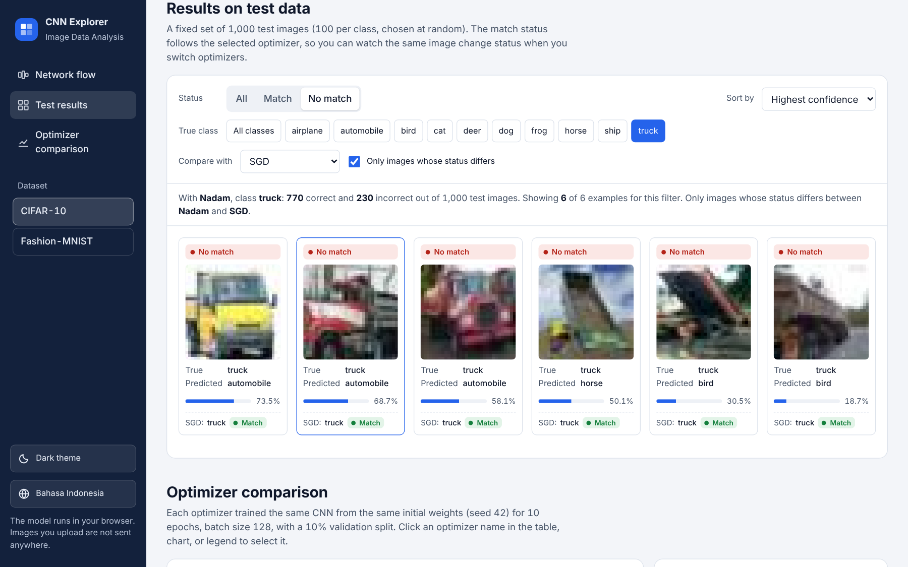
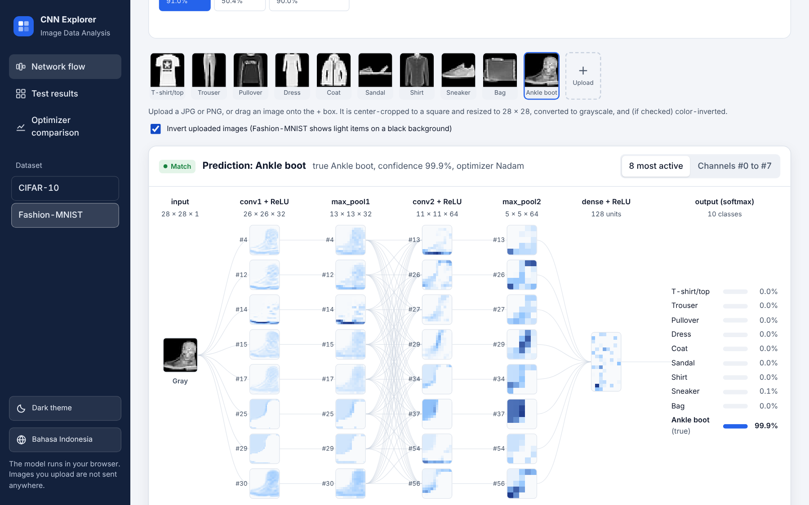

# CNN Optimizer Explorer

**English** | [Bahasa Indonesia](README.id.md)

An interactive web page that opens up a small convolutional neural network (CNN) and shows what it does with an image, layer by layer. You can switch between two datasets (CIFAR-10 photos and Fashion-MNIST clothing) and between eight optimizers, upload your own picture, and see where the model gets things right and wrong.

**Live dashboard: https://febrianggi.github.io/CNN-Implementer/**

Everything runs in your browser. There is no server and nothing you upload leaves your computer.


## What is this for?

A CNN is often explained with diagrams of boxes and arrows. This page shows the real thing: actual feature maps and kernels from trained models, computed live for the image you choose. It is built for students and anyone learning how CNNs work, and it answers three questions:

- **What does each layer do to an image?** Follow one picture from its color channels to the final class probabilities.
- **Does the optimizer matter?** The same network was trained eight times, once per optimizer, from identical starting weights. Switch between them and compare.
- **Does the dataset matter?** The same architecture is trained on easy grayscale clothing images and on harder color photos.

The layout of the network view is inspired by [CNN Explainer](https://poloclub.github.io/cnn-explainer/).

## How to use the dashboard

The page has three sections, reachable from the sidebar: **Network flow**, **Test results**, and **Optimizer comparison**. The controls at the top apply to all three.

1. **Choose a dataset.** CIFAR-10 (32 × 32 color photos of airplanes, cats, trucks, and so on) or Fashion-MNIST (28 × 28 grayscale images of shirts, sneakers, bags, and so on). The switch is also in the sidebar.
2. **Choose an optimizer.** The card next to the buttons explains how that optimizer updates the weights, when it is usually used, and how well it did.
3. **Choose an image.** Click one of the ten example thumbnails, or press **+** to upload your own JPG or PNG (you can also drag a file onto it). Uploads are center-cropped and resized to the dataset's size. For Fashion-MNIST they are also converted to grayscale and, by default, color-inverted, because Fashion-MNIST shows light items on a black background.
4. **Read the network flow from left to right.**
   - **input**: the image's color channels (red, green, blue for CIFAR-10; one gray channel for Fashion-MNIST).
   - **conv1** and **conv2**: each square is a *feature map*, the output of one learned 3 × 3 filter. Bright areas are where the filter found its pattern. Only 8 of the 32 or 64 maps are shown; switch between "8 most active" and "Channels #0 to #7".
   - **max_pool**: keeps the strongest value in every 2 × 2 block, halving the size.
   - **dense**: 128 numbers that summarize the image.
   - **output**: the probability of each of the 10 classes. The label above the flow says whether the top prediction matches the true class.
5. **Click any feature map** to enlarge it and see the kernel weights that produced it (red is negative, blue is positive).
6. **Compare all optimizers on one image.** "Compare all optimizers" shows each optimizer's prediction and confidence for the current image. Click a card to switch to that optimizer.
7. **Browse the test results.** A fixed set of 1,000 test images (100 per class), each card showing the true label, the prediction, the confidence, and a *Match* or *No match* label. Filter by status and by class, for example "truck" + "No match". Pick a second optimizer under *Compare with* and tick *Only images whose status differs* to find images where two optimizers disagree. Click a card to inspect it in the network flow.
8. **Compare the optimizers.** A summary table, test-accuracy bars, validation curves for all eight optimizers, train vs validation curves, accuracy per class, and a confusion matrix. Click a confusion-matrix cell to open those exact mistakes in the gallery.

The sidebar also has a light/dark theme switch and an English/Indonesian language switch.

| One image, eight optimizers | Finding disagreements in the test set |
|---|---|
|  |  |

| Fashion-MNIST in the network flow | Optimizer comparison |
|---|---|
|  |  |

## How it works

The models are trained once in Python, and the page then runs them in JavaScript:

```
Python (TensorFlow / Keras)                         Browser (GitHub Pages)
───────────────────────────                         ──────────────────────
src/train.py                                        dashboard/index.html
  trains 1 MLP + 8 CNNs per dataset                   loads data.json for the chosen dataset
        │                                             loads w-<optimizer>.json when needed
        ▼                                             runs the CNN in plain JavaScript:
models/<dataset>/*.keras                                conv → ReLU → max pool → conv → ReLU
        │                                               → max pool → dense → softmax
        ▼                                             draws every intermediate result
src/export_dashboard.py
  writes dashboard/data/<dataset>/
    data.json          test images, predictions, confusion matrices, training curves
    w-<optimizer>.json CNN weights (16-bit floats, under 1 MB each)
```

- **No server.** The dashboard is a static page with JSON files beside it, so GitHub Pages can host it as is.
- **The browser does the math.** The forward pass is re-implemented in about 40 lines of JavaScript. Its probabilities match Keras to within 0.000001 on the same weights.
- **Light weights.** Weights are stored as 16-bit floats. Every number on the page (accuracy, confusion matrices, gallery predictions) is recomputed from those rounded weights, so the page and the files always agree.
- **Uploads stay local.** An uploaded image is read with the browser's canvas API and never sent anywhere.

## The model

The same architecture for both datasets; only the input size changes.

| Layer | CIFAR-10 output | Fashion-MNIST output | Parameters (CIFAR-10 / Fashion-MNIST) |
|---|---|---|---|
| Input | 32 × 32 × 3 | 28 × 28 × 1 | |
| Conv2D, 32 filters 3 × 3, ReLU | 30 × 30 × 32 | 26 × 26 × 32 | 896 / 320 |
| MaxPooling 2 × 2 | 15 × 15 × 32 | 13 × 13 × 32 | |
| Conv2D, 64 filters 3 × 3, ReLU | 13 × 13 × 64 | 11 × 11 × 64 | 18,496 / 18,496 |
| MaxPooling 2 × 2 | 6 × 6 × 64 | 5 × 5 × 64 | |
| Flatten | 2,304 | 1,600 | |
| Dense 128, ReLU, Dropout 0.3 | 128 | 128 | 295,040 / 204,928 |
| Dense 10, softmax | 10 | 10 | 1,290 / 1,290 |
| **Total** | | | **315,722 / 225,034** |

The MLP baseline flattens the image and uses Dense 256 → Dense 128 → Dense 10.

Training setup for every run: seed 42 (identical starting weights), 10 epochs, batch size 128, 10% of the training set held out for validation, Keras default learning rates except the extra *SGD + momentum* run (learning rate 0.05, momentum 0.9, Nesterov).

## Results

Accuracy on each dataset's 10,000 test images.

### CIFAR-10

| Model | Optimizer | Test accuracy | Test loss | Best val accuracy (epoch) | Train−val gap |
|---|---|---|---|---|---|
| CNN | Nadam | 68.88% | 0.910 | 67.56% (10) | +4.8 pts |
| CNN | RMSprop | 68.53% | 0.944 | 66.86% (10) | +7.6 pts |
| CNN | Adam | 67.86% | 0.927 | 65.44% (10) | +6.0 pts |
| CNN | AdamW | 67.74% | 0.929 | 66.24% (10) | +4.9 pts |
| CNN | SGD + momentum | 64.10% | 1.186 | 64.64% (10) | +11.0 pts |
| CNN | SGD | 47.48% | 1.457 | 45.92% (10) | −1.0 pts |
| CNN | Adagrad | 31.93% | 1.940 | 30.02% (10) | −1.8 pts |
| CNN | Adadelta | 16.07% | 2.288 | 14.74% (10) | −0.6 pts |
| MLP | Adam | 46.87% | | | |

### Fashion-MNIST

| Model | Optimizer | Test accuracy | Test loss | Best val accuracy (epoch) | Train−val gap |
|---|---|---|---|---|---|
| CNN | RMSprop | 91.04% | 0.252 | 91.35% (10) | +1.5 pts |
| CNN | Adam | 91.03% | 0.257 | 90.87% (10) | +1.6 pts |
| CNN | Nadam | 90.96% | 0.254 | 90.92% (10) | +1.6 pts |
| CNN | AdamW | 90.61% | 0.259 | 91.03% (10) | +1.4 pts |
| CNN | SGD + momentum | 89.97% | 0.286 | 90.53% (9) | +1.6 pts |
| CNN | SGD | 81.63% | 0.497 | 81.93% (10) | −1.2 pts |
| CNN | Adagrad | 73.82% | 0.752 | 74.18% (10) | −3.7 pts |
| CNN | Adadelta | 50.41% | 1.942 | 50.35% (10) | −6.7 pts |
| MLP | Adam | 87.29% | | | |

What stands out:

- **Adaptive optimizers finish close together.** Adam, AdamW, Nadam, and RMSprop end within about a point of each other on both datasets. With one run per optimizer, gaps that small are not evidence that one is better.
- **Default learning rates matter.** SGD, Adagrad, and Adadelta use small default learning rates and are still far from converged after 10 epochs. The effect is much bigger on CIFAR-10. Giving SGD momentum and a larger learning rate closes most of the gap.
- **CNNs help most on harder images.** On CIFAR-10 the CNN beats the MLP by 21.0 points with fewer than half the parameters. On Fashion-MNIST the gap is only 3.7 points, because centered clothing silhouettes on a black background are already easy for an MLP.

Full numbers are in [`results/`](results/).

## Data

| Dataset | Link | Used here |
|---|---|---|
| CIFAR-10 | https://www.cs.toronto.edu/~kriz/cifar.html | 60,000 color images, 32 × 32, 10 classes (50,000 train, 10,000 test) |
| CIFAR-10 as image files | https://github.com/YoongiKim/CIFAR-10-images | The copy the published CIFAR-10 models were trained on |
| Fashion-MNIST | https://github.com/zalandoresearch/fashion-mnist | 70,000 grayscale images, 28 × 28, 10 classes (60,000 train, 10,000 test) |

The published CIFAR-10 models were trained on the JPG-file copy, whose pixels differ slightly from the official binary version because of JPG compression. Training on the official data gives slightly different numbers.

Citations:
- Alex Krizhevsky. *Learning Multiple Layers of Features from Tiny Images*. 2009.
- Han Xiao, Kashif Rasul, Roland Vollgraf. *Fashion-MNIST: a Novel Image Dataset for Benchmarking Machine Learning Algorithms*. arXiv:1708.07747, 2017.

## Repository layout

```
.
├── index.html                  sends GitHub Pages visitors to the dashboard
├── dashboard/
│   ├── index.html              the dashboard (English)
│   ├── index.id.html           the dashboard (Indonesian)
│   └── data/
│       ├── summary.json        MLP vs CNN numbers for both datasets
│       ├── cifar10/            data.json + w-<optimizer>.json
│       └── fashion/            data.json + w-<optimizer>.json
├── src/
│   ├── train.py                trains the MLP and the 8 CNNs for one dataset
│   └── export_dashboard.py     turns trained models into dashboard/data/<dataset>/
├── notebooks/
│   └── cnn_optimizers.ipynb    the same training, step by step with explanations
├── results/                    results tables and training histories
├── docs/screenshots/           images used in this README
└── requirements.txt
```

## Run it yourself

### Open the dashboard on your computer

The page loads its data with `fetch`, which browsers block for files opened directly from disk. Start a small local web server instead:

```bash
cd dashboard
python -m http.server 8000
```

Then open http://localhost:8000 (English) or http://localhost:8000/index.id.html (Indonesian).

### Publish your own copy with GitHub Pages

1. Fork or push this repository to GitHub.
2. Open **Settings → Pages**, set **Source** to *Deploy from a branch*, and choose the `main` branch and the `/ (root)` folder.
3. After a minute the site is live at `https://<your-username>.github.io/<repository-name>/`. The root `index.html` forwards visitors to the dashboard.

### Retrain the models

```bash
pip install -r requirements.txt

python src/train.py --dataset cifar10        # about 15 minutes on a laptop CPU
python src/export_dashboard.py --dataset cifar10

python src/train.py --dataset fashion        # about 12 minutes on a laptop CPU
python src/export_dashboard.py --dataset fashion
```

Both scripts download the data through `keras.datasets` by default. To use local copies instead, pass `--source files --data-dir <folder>` (the CIFAR-10 image-file copy, or the four `.gz` files from the Fashion-MNIST repository). Add `--epochs 1 --limit 2000` for a quick test. Trained models go to `models/`, which git ignores.

### Follow along in a notebook

[`notebooks/cnn_optimizers.ipynb`](notebooks/cnn_optimizers.ipynb) runs the same analysis step by step, with an explanation under every step: exploring the data, building the models, checking the parameter count by hand, evaluating the CNN, and the optimizer experiment. Set `DATASET = "cifar10"` or `"fashion"` in the first code cell. Explanations are in English, each with an expandable Indonesian translation.

To open it in Google Colab: **File → Open notebook → GitHub**, paste this repository's URL, and choose the notebook. Use a GPU runtime (*Runtime → Change runtime type → T4 GPU*); a full run takes about 10 minutes per dataset.

Versions used: Python 3.13, TensorFlow 2.21, Keras 3.15, NumPy 2.5, Pillow 12.3.

## Limitations

- Each optimizer was trained once with one seed. Differences of about a point between optimizers are within run-to-run noise.
- All runs stop at 10 epochs. The better optimizers are still improving at the last epoch, so longer training would raise every number.
- Your own uploads are judged by models that only know the 10 classes of the selected dataset at very low resolution. A photo of a dog that does not fill the frame will often be misread.

## Author

Febrianggi Caesar Immanuel, Statistics, Universitas Padjadjaran. GitHub: [@Febrianggi](https://github.com/Febrianggi)
