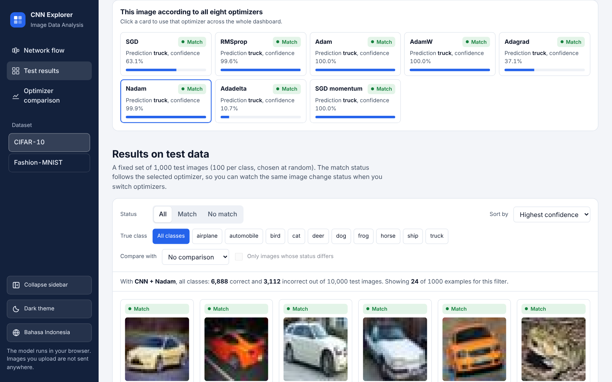
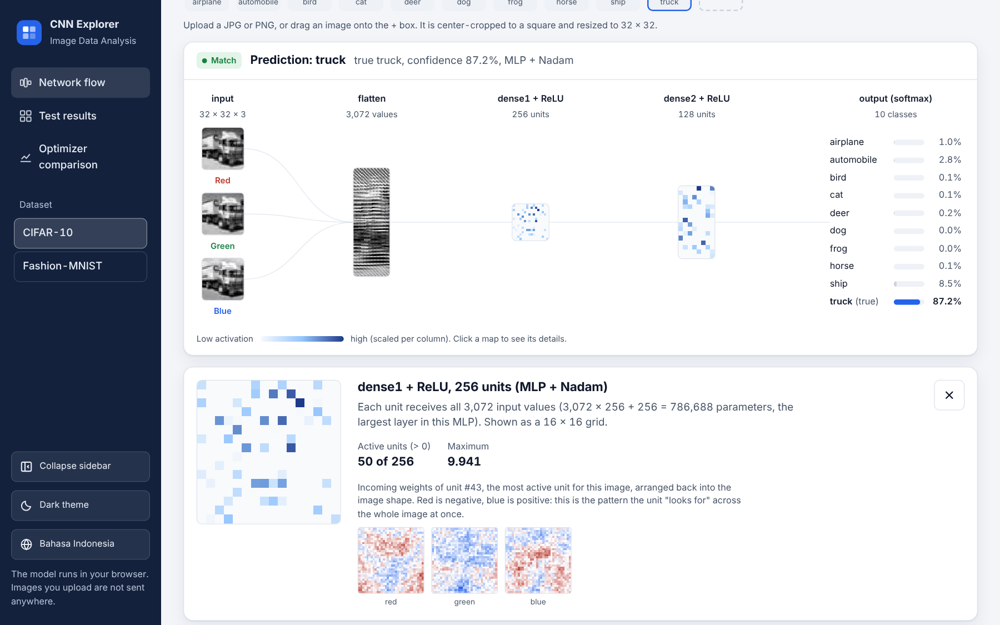
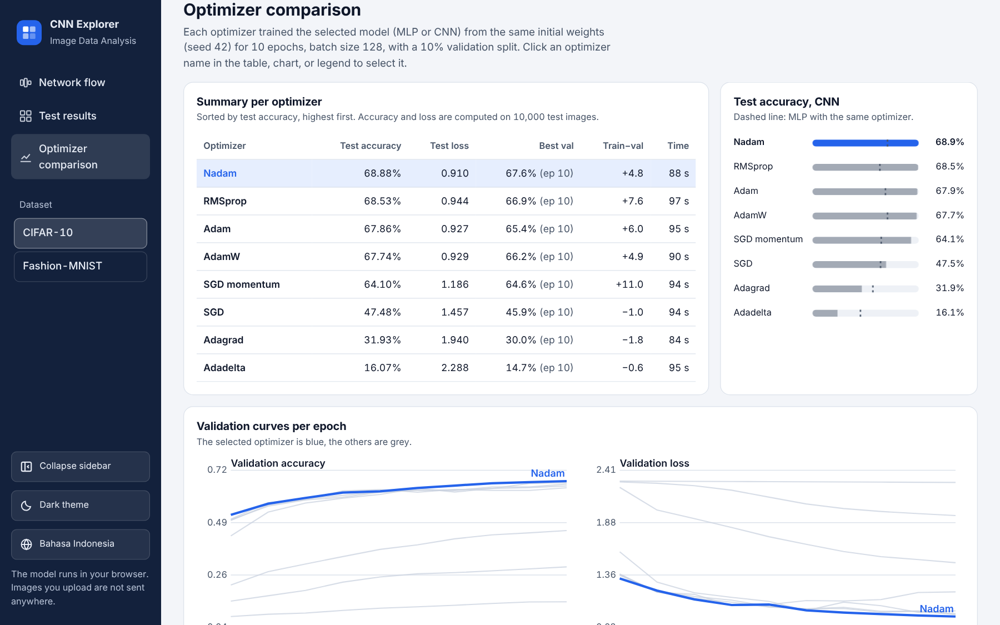
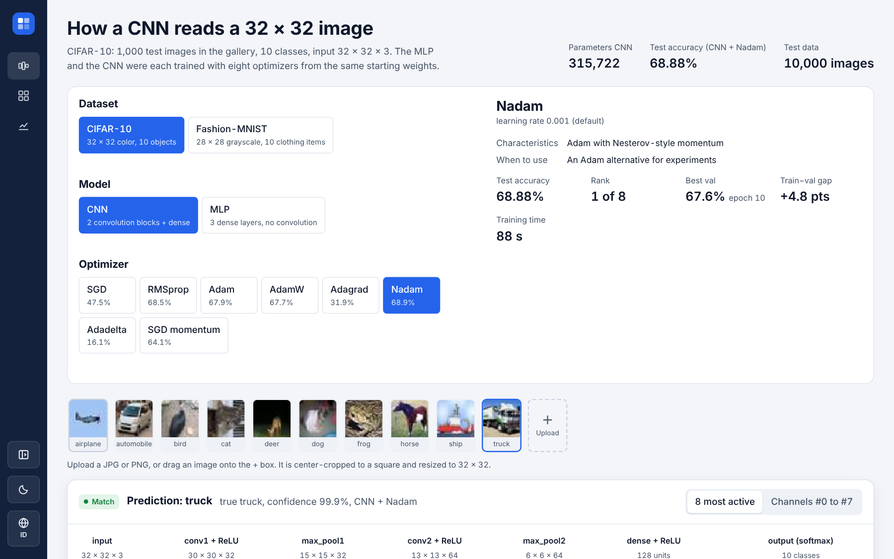

# CNN Optimizer Explorer

**English** | [Bahasa Indonesia](README.id.md)

An interactive web page that opens up a small convolutional neural network (CNN) and shows what it does with an image, layer by layer. You can switch between two datasets (CIFAR-10 photos and Fashion-MNIST clothing), two architectures (a CNN and a plain MLP), and eight optimizers, upload your own picture, and see where the model gets things right and wrong.

**Live dashboard: https://febrianggi.github.io/CNN-Implementer/**

Everything runs in your browser. There is no server and nothing you upload leaves your computer.


## What is this for?

A CNN is often explained with diagrams of boxes and arrows. This page shows the real thing: actual feature maps and kernels from trained models, computed live for the image you choose. It is built for students and anyone learning how CNNs work, and it answers three questions:

- **What does each layer do to an image?** Follow one picture from its color channels to the final class probabilities.
- **Does the optimizer matter?** The same network was trained eight times, once per optimizer, from identical starting weights. Switch between them and compare.
- **Does convolution matter?** The same data and optimizers also train an MLP with no convolution at all, so you can compare it with the CNN image by image.
- **Does the dataset matter?** The same architectures are trained on easy grayscale clothing images and on harder color photos.

The layout of the network view is inspired by [CNN Explainer](https://poloclub.github.io/cnn-explainer/).

## How to use the dashboard

The page has three sections, reachable from the sidebar: **Network flow**, **Test results**, and **Optimizer comparison**. The controls at the top apply to all three.

1. **Choose a dataset.** CIFAR-10 (32 × 32 color photos of airplanes, cats, trucks, and so on) or Fashion-MNIST (28 × 28 grayscale images of shirts, sneakers, bags, and so on). The switch is also in the sidebar.
2. **Choose a model.** *CNN* (two convolution blocks, then a dense layer) or *MLP* (three dense layers, no convolution). With the MLP, the flow shows the image flattened into one long vector and passed through two dense layers.
3. **Choose an optimizer.** The card next to the buttons explains how that optimizer updates the weights, when it is usually used, and how well it did with the selected model.
4. **Choose an image.** Click one of the ten example thumbnails, or press **+** to upload your own JPG or PNG (you can also drag a file onto it). Uploads are center-cropped and resized to the dataset's size. For Fashion-MNIST they are also converted to grayscale and, by default, color-inverted, because Fashion-MNIST shows light items on a black background.
5. **Read the network flow from left to right.**
   - **input**: the image's color channels (red, green, blue for CIFAR-10; one gray channel for Fashion-MNIST).
   - **conv1** and **conv2** (CNN): each square is a *feature map*, the output of one learned 3 × 3 filter. Bright areas are where the filter found its pattern. Only 8 of the 32 or 64 maps are shown; switch between "8 most active" and "Channels #0 to #7".
   - **max_pool** (CNN): keeps the strongest value in every 2 × 2 block, halving the size.
   - **flatten** (MLP): every pixel value in one long vector. From here on the model no longer knows which pixels were neighbours.
   - **dense**: layers of units that each combine all of their inputs; the last one summarizes the image in 128 numbers.
   - **output**: the probability of each of the 10 classes. The label above the flow says whether the top prediction matches the true class.
6. **Click any square** to enlarge it. For a CNN feature map you see the kernel weights that produced it (red is negative, blue is positive). For the MLP's *dense1* you see the incoming weights of its most active unit drawn back as an image: the pattern that unit looks for.
7. **Compare all optimizers on one image.** "Compare all optimizers" shows each optimizer's prediction and confidence for the current image. Click a card to switch to that optimizer.
8. **Browse the test results.** A fixed set of 1,000 test images (100 per class), each card showing the true label, the prediction, the confidence, and a *Match* or *No match* label. Filter by status and by class, for example "truck" + "No match". Pick a second optimizer under *Compare with* and tick *Only images whose status differs* to find images where two optimizers disagree. Click a card to inspect it in the network flow.
9. **Compare the optimizers.** A summary table, test-accuracy bars, validation curves for all eight optimizers, train vs validation curves, accuracy per class, a confusion matrix, and an MLP vs CNN table for the selected optimizer. Click a confusion-matrix cell to open those exact mistakes in the gallery.

The sidebar holds the section links and a dataset switch. *Collapse sidebar* shrinks it to icons to give the flow more room, and there are also a light/dark theme switch and an English/Indonesian language switch.

| One image, eight optimizers | Finding disagreements in the test set |
|---|---|
|  |  |

| The MLP: flatten, then dense layers | Fashion-MNIST in the network flow |
|---|---|
|  |  |

| Optimizer comparison | Sidebar collapsed to icons |
|---|---|
|  |  |

## How it works

The models are trained once in Python, and the page then runs them in JavaScript:

```
Python (TensorFlow / Keras)                         Browser (GitHub Pages)
───────────────────────────                         ──────────────────────
src/train.py                                        dashboard/index.html
  trains an MLP and a CNN with 8 optimizers each      loads data.json for the chosen dataset
        │                                             loads w-<model>-<optimizer>.json when needed
        ▼                                             runs the model in plain JavaScript:
models/<dataset>/*.keras  (included in this repo)       CNN: conv → ReLU → max pool → conv → ReLU
        │                                                    → max pool → dense → softmax
        ▼                                               MLP: flatten → dense → dense → softmax
src/export_dashboard.py                               draws every intermediate result
  writes dashboard/data/<dataset>/
    data.json                  test images, predictions, confusion matrices, training curves
    w-<model>-<optimizer>.json weights (16-bit floats, about 0.5 to 2 MB each)
```

- **No server.** The dashboard is a static page with JSON files beside it, so GitHub Pages can host it as is.
- **The browser does the math.** The forward pass is re-implemented in about 40 lines of JavaScript. Its probabilities match Keras to within 0.000001 on the same weights.
- **Light weights.** Weights are stored as 16-bit floats. Every number on the page (accuracy, confusion matrices, gallery predictions) is recomputed from those rounded weights, so the page and the files always agree.
- **Uploads stay local.** An uploaded image is read with the browser's canvas API and never sent anywhere.

## The models

The same two architectures for both datasets; only the input size changes.

**CNN**

| Layer | CIFAR-10 output | Fashion-MNIST output | Parameters (CIFAR-10 / Fashion-MNIST) |
|---|---|---|---|
| Input | 32 × 32 × 3 | 28 × 28 × 1 | |
| Conv2D, 32 filters 3 × 3, ReLU | 30 × 30 × 32 | 26 × 26 × 32 | 896 / 320 |
| MaxPooling 2 × 2 | 15 × 15 × 32 | 13 × 13 × 32 | |
| Conv2D, 64 filters 3 × 3, ReLU | 13 × 13 × 64 | 11 × 11 × 64 | 18,496 / 18,496 |
| MaxPooling 2 × 2 | 6 × 6 × 64 | 5 × 5 × 64 | |
| Flatten | 2,304 | 1,600 | |
| Dense 128, ReLU, Dropout 0.3 | 128 | 128 | 295,040 / 204,928 |
| Dense 10, softmax | 10 | 10 | 1,290 / 1,290 |
| **Total** | | | **315,722 / 225,034** |

**MLP**

| Layer | CIFAR-10 output | Fashion-MNIST output | Parameters (CIFAR-10 / Fashion-MNIST) |
|---|---|---|---|
| Flatten | 3,072 | 784 | |
| Dense 256, ReLU | 256 | 256 | 786,688 / 200,960 |
| Dense 128, ReLU | 128 | 128 | 32,896 / 32,896 |
| Dense 10, softmax | 10 | 10 | 1,290 / 1,290 |
| **Total** | | | **820,874 / 235,146** |

Training setup for every run: seed 42 (identical starting weights), 10 epochs, batch size 128, 10% of the training set held out for validation, Keras default learning rates except the extra *SGD + momentum* run (learning rate 0.05, momentum 0.9, Nesterov).

## Results

Accuracy on each dataset's 10,000 test images.

### CIFAR-10

| Optimizer | CNN test accuracy | MLP test accuracy | CNN − MLP |
|---|---|---|---|
| Nadam | 68.88% | 48.17% | +20.71 pts |
| RMSprop | 68.53% | 43.08% | +25.45 pts |
| Adam | 67.86% | 46.87% | +20.99 pts |
| AdamW | 67.74% | 48.20% | +19.54 pts |
| SGD + momentum | 64.10% | 43.99% | +20.11 pts |
| SGD | 47.48% | 43.47% | +4.01 pts |
| Adagrad | 31.93% | 38.58% | −6.65 pts |
| Adadelta | 16.07% | 30.69% | −14.62 pts |

### Fashion-MNIST

| Optimizer | CNN test accuracy | MLP test accuracy | CNN − MLP |
|---|---|---|---|
| RMSprop | 91.04% | 87.43% | +3.61 pts |
| Adam | 91.03% | 87.29% | +3.74 pts |
| Nadam | 90.96% | 87.72% | +3.24 pts |
| AdamW | 90.61% | 86.62% | +3.99 pts |
| SGD + momentum | 89.97% | 87.46% | +2.51 pts |
| SGD | 81.63% | 84.28% | −2.65 pts |
| Adagrad | 73.82% | 80.03% | −6.21 pts |
| Adadelta | 50.41% | 66.55% | −16.14 pts |

Test loss, best validation accuracy, the train−validation gap, and training time for all 32 runs are in [`results/`](results/).

What stands out:

- **Adaptive optimizers finish close together.** For the CNN, Adam, AdamW, Nadam, and RMSprop end within about a point of each other on both datasets. With one run per optimizer, gaps that small are not evidence that one is better.
- **Default learning rates matter.** SGD, Adagrad, and Adadelta use small default learning rates and are still far from converged after 10 epochs. Giving SGD momentum and a larger learning rate closes most of the gap.
- **CNNs help most on harder images.** With Adam, the CNN beats the MLP by 21.0 points on CIFAR-10 while using fewer than half the parameters. On Fashion-MNIST the gap is only 3.7 points, because centered clothing silhouettes on a black background are already easy for an MLP.
- **The CNN's advantage needs an optimizer that actually trains it.** With the slow defaults the order flips: the MLP beats the CNN with Adagrad and Adadelta on both datasets, and with plain SGD on Fashion-MNIST. In 10 epochs at those small learning rates, the CNN simply has not learned enough yet.


## Data

| Dataset | Link | Used here |
|---|---|---|
| CIFAR-10 | https://www.cs.toronto.edu/~kriz/cifar.html | 60,000 color images, 32 × 32, 10 classes (50,000 train, 10,000 test) |
| CIFAR-10 as image files | https://github.com/YoongiKim/CIFAR-10-images | The copy the published CIFAR-10 models were trained on |
| Fashion-MNIST | https://github.com/zalandoresearch/fashion-mnist | 70,000 grayscale images, 28 × 28, 10 classes (60,000 train, 10,000 test) |

The published CIFAR-10 models were trained on the JPG-file copy, whose pixels differ slightly from the official binary version because of JPG compression. Training on the official data gives slightly different numbers.

Citations:
- Alex Krizhevsky. *Learning Multiple Layers of Features from Tiny Images*. 2009.
- Han Xiao, Kashif Rasul, Roland Vollgraf. *Fashion-MNIST: a Novel Image Dataset for Benchmarking Machine Learning Algorithms*. arXiv:1708.07747, 2017.

## Repository layout

```
.
├── index.html                  sends GitHub Pages visitors to the dashboard
├── dashboard/
│   ├── index.html              the dashboard (English)
│   ├── index.id.html           the dashboard (Indonesian)
│   └── data/
│       ├── summary.json        MLP vs CNN accuracy for both datasets
│       ├── cifar10/            data.json + w-<model>-<optimizer>.json
│       └── fashion/            data.json + w-<model>-<optimizer>.json
├── models/
│   ├── cifar10/                <model>-<optimizer>.keras + .history.json (16 trained models)
│   └── fashion/                <model>-<optimizer>.keras + .history.json (16 trained models)
├── src/
│   ├── train.py                trains the MLP and the CNN with 8 optimizers for one dataset
│   └── export_dashboard.py     turns trained models into dashboard/data/<dataset>/
├── notebooks/
│   └── cnn_optimizers.ipynb    the same training, step by step with explanations
├── results/                    results tables and training histories
├── docs/screenshots/           images used in this README
└── requirements.txt
```

## Run it yourself

### Open the dashboard on your computer

The page loads its data with `fetch`, which browsers block for files opened directly from disk. Start a small local web server instead:

```bash
cd dashboard
python -m http.server 8000
```

Then open http://localhost:8000 (English) or http://localhost:8000/index.id.html (Indonesian).

### Publish your own copy with GitHub Pages

1. Fork or push this repository to GitHub.
2. Open **Settings → Pages**, set **Source** to *Deploy from a branch*, and choose the `main` branch and the `/ (root)` folder.
3. After a minute the site is live at `https://<your-username>.github.io/<repository-name>/`. The root `index.html` forwards visitors to the dashboard.

### Retrain the models

```bash
pip install -r requirements.txt

python src/train.py --dataset cifar10        # 16 runs, about 20 minutes on a laptop CPU
python src/export_dashboard.py --dataset cifar10

python src/train.py --dataset fashion        # 16 runs, about 15 minutes on a laptop CPU
python src/export_dashboard.py --dataset fashion
```

Both scripts download the data through `keras.datasets` by default. To use local copies instead, pass `--source files --data-dir <folder>` (the CIFAR-10 image-file copy, or the four `.gz` files from the Fashion-MNIST repository). Use `--models mlp` or `--models cnn` to train only one architecture, and `--epochs 1 --limit 2000` for a quick test.

### Use the trained models

The 32 models behind the dashboard are in [`models/`](models/), saved as weights without optimizer state (about 1 to 3 MB each). Each comes with a `.history.json` holding its per-epoch training curves, test accuracy, and training time.

```python
import keras
model = keras.models.load_model("models/cifar10/cnn-adam.keras")
model.summary()
```

Inputs must be scaled to 0–1 with shape `(N, 32, 32, 3)` for CIFAR-10 or `(N, 28, 28, 1)` for Fashion-MNIST.

### Follow along in a notebook

[`notebooks/cnn_optimizers.ipynb`](notebooks/cnn_optimizers.ipynb) runs the same analysis step by step, with an explanation under every step: exploring the data, building the models, checking the parameter count by hand, evaluating the CNN, and the optimizer experiment for both the MLP and the CNN. Set `DATASET = "cifar10"` or `"fashion"` in the first code cell. Explanations are in English, each with an expandable Indonesian translation.

To open it in Google Colab: **File → Open notebook → GitHub**, paste this repository's URL, and choose the notebook. Use a GPU runtime (*Runtime → Change runtime type → T4 GPU*); a full run takes about 10 minutes per dataset.

Versions used: Python 3.13, TensorFlow 2.21, Keras 3.15, NumPy 2.5, Pillow 12.3.

## Limitations

- Each optimizer was trained once with one seed. Differences of about a point between optimizers are within run-to-run noise.
- All runs stop at 10 epochs. The better optimizers are still improving at the last epoch, so longer training would raise every number.
- Your own uploads are judged by models that only know the 10 classes of the selected dataset at very low resolution. A photo of a dog that does not fill the frame will often be misread.

## Author

Febrianggi Caesar Immanuel, Statistics, Universitas Padjadjaran. GitHub: [@Febrianggi](https://github.com/Febrianggi)
